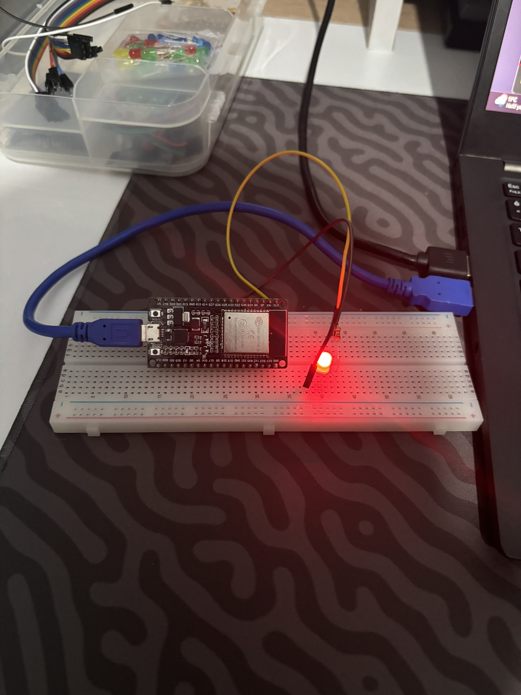

# ESP32 — Proje 1: Doğal ESP-IDF ile LED Kontrolü ve Dahili BOOT Butonu Okuma

Bu proje, ESP-WROOM-32 geliştirme kartı üzerinde **Arduino soyutlaması olmadan**, tamamen Espressif'in resmi **ESP-IDF v6.1 (C / FreeRTOS)** framework'ü kullanılarak geliştirilmiştir. 

Projede kademeli olarak iki aşama tamamlanmıştır:
1. **Aşama 1:** FreeRTOS görev zamanlayıcısı ile harici LED'in otomatik yanıp sönmesi (Blink).
2. **Aşama 2:** Kart üzerindeki dahili BOOT butonunun (GPIO 0) Active-Low mantığı ile taranarak LED'in butonla kontrol edilmesi.

---

## 🛠️ Donanım Gereksinimleri

* 1 × **ESP-WROOM-32** Geliştirme Kartı (Dual-Core Xtensa @ 240 MHz)
* 1 × **Kırmızı LED** (5mm)
* 1 × **220Ω - 330Ω Direnç** (Akım sınırlayıcı)
* 1 × **Breadboard** ve Jumper Kablolar
* 1 × **Dahili BOOT Butonu** (ESP32 kartı üzerinde GPIO 0'a bağlı)

---

## 🔌 Pin Bağlantı Şeması

| Bileşen | Pin / Bacak | ESP32 GPIO | Açıklama |
| :--- | :--- | :--- | :--- |
| **Harici LED** | Anot (+) Uzun Bacak | **GPIO 25** | Dijital Çıkış (`GPIO_MODE_OUTPUT`) |
| **Harici LED** | Katot (-) Kısa Bacak | **GND** | 220Ω Direnç üzerinden toprağa bağlı |
| **Dahili Buton** | BOOT Butonu | **GPIO 0** | Dahili Pull-Up (`GPIO_PULLUP_ONLY`), Active-Low |

---

## 🧠 Öğrenilen Temel Kavramlar & Teori

1. **Saf ESP-IDF Mimarisi (`void app_main(void)`):**
   * Arduino'nun `setup()` ve `loop()` yapısı yerine FreeRTOS çekirdeği tarafından başlatılan ana uygulama görevi (`app_main`) kullanılır.
2. **Doğal GPIO Sürücüsü (`driver/gpio.h`):**
   * `gpio_reset_pin(pin)`: Pini varsayılan fabrika durumuna sıfırlar.
   * `gpio_set_direction(pin, mode)`: Pinin giriş (`GPIO_MODE_INPUT`) veya çıkış (`GPIO_MODE_OUTPUT`) yönünü belirler.
   * `gpio_set_pull_mode(pin, mode)`: Dahili pull-up direncini (`GPIO_PULLUP_ONLY`) açarak pini boştayken kararlı 3.3V seviyesinde tutar.
   * `gpio_set_level(pin, level)`: Çıkış pinine 0V (0) veya 3.3V (1) verir.
   * `gpio_get_level(pin)`: Giriş pinindeki voltaj seviyesini (0 veya 1) okur.
3. **Active-Low Lojik:**
   * ESP32 BOOT butonu basılmadığında dahili pull-up sayesinde `1` (HIGH) seviyesindedir.
   * Butona basıldığında buton pini doğrudan GND'ye çektiği için `0` (LOW) seviyesine düşer.
4. **FreeRTOS Watchdog (TWDT) ve CPU Nefes Alma:**
   * `while(1)` sonsuz döngüsü içinde `vTaskDelay(10 / portTICK_PERIOD_MS);` çağrılarak FreeRTOS IDLE görevine işlemci zamanı verilir ve Task Watchdog sıfırlanır.

---

## 💻 1. Aşama Kodu: Temel LED Blink (Zaman Ayarlı Yanıp Sönme)

Bu aşamada LED, FreeRTOS'un `vTaskDelay` fonksiyonu kullanılarak 500ms aralıklarla periyodik olarak yakılıp söndürülür:

```c
#include <stdio.h>
#include "freertos/FreeRTOS.h"
#include "freertos/task.h"
#include "driver/gpio.h"

#define LED_PIN GPIO_NUM_25

void app_main(void) {
    // LED pinini sıfırla ve çıkış olarak ayarla
    gpio_reset_pin(LED_PIN);
    gpio_set_direction(LED_PIN, GPIO_MODE_OUTPUT);

    while (1) {
        gpio_set_level(LED_PIN, 1);                  // LED'i Yak
        vTaskDelay(500 / portTICK_PERIOD_MS);       // 500 ms Bekle
        gpio_set_level(LED_PIN, 0);                  // LED'i Söndür
        vTaskDelay(500 / portTICK_PERIOD_MS);       // 500 ms Bekle
    }
}
```

---

## 💻 2. Aşama Kodu: BOOT Butonu ile Etkileşimli Kontrol (Nihai Kod)

Bu aşamada kart üzerindeki BOOT butonu okunarak LED'in durumu butona basılmasına göre anlık olarak güncellenir:

```c
#include <stdio.h>
#include "freertos/FreeRTOS.h"
#include "freertos/task.h"
#include "driver/gpio.h"

#define LED_PIN GPIO_NUM_25
#define BUTTON_PIN GPIO_NUM_0

void app_main(void) {
    // LED Pini Yapılandırması (Çıkış)
    gpio_reset_pin(LED_PIN);
    gpio_set_direction(LED_PIN, GPIO_MODE_OUTPUT);

    // BOOT Buton Pini Yapılandırması (Giriş + Dahili Pull-Up)
    gpio_reset_pin(BUTTON_PIN);
    gpio_set_direction(BUTTON_PIN, GPIO_MODE_INPUT);
    gpio_set_pull_mode(BUTTON_PIN, GPIO_PULLUP_ONLY);

    while (1) {
        // Active-Low: Butona basıldığında GPIO 0 seviyesi 0 olur
        if (gpio_get_level(BUTTON_PIN) == 0) {
            gpio_set_level(LED_PIN, 1); // Butona basılıyorsa LED'i yak
        } else {
            gpio_set_level(LED_PIN, 0); // Buton bırakıldığında LED'i söndür
        }

        // FreeRTOS görev zamanlayıcısına işlemci bırakma ve debouncing
        vTaskDelay(10 / portTICK_PERIOD_MS);
    }
}
```

---

## 🔨 Derleme ve Karta Yükleme (Terminalden)

Proje dizininde terminalden şu komut çalıştırılarak doğrudan inşa edilir ve flaşlanır:

```powershell
idf.py -p COM4 build flash
```

---

## 📸 Uygulama Görselleri

| Aşama 1 & 2: LED Blink ve BOOT Butonu Devresi (`delay.JPEG`) |
| :---: |
|  |
