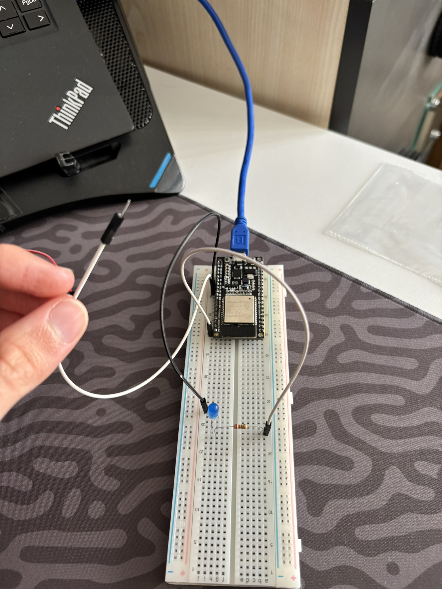
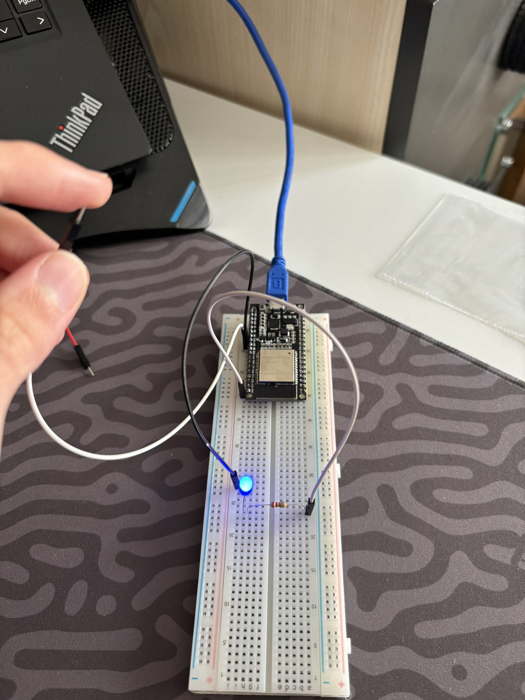

# 02 — Dahili Kapasitif Dokunmatik Sensör ve Gösterge LED'i

Bu proje, **ESP-WROOM-32** mikrodenetleyicisinin dahili donanımsal kapasitif algılayıcı (**Capacitive Touch Sensor**) birimini ve FreeRTOS tabanlı **resmi ESP-IDF v6.1** ekosistemini kullanarak parmak dokunuşunu algılamayı ve harici bir gösterge LED'ini sürmeyi hedefler.

---

## 🎯 Hedefler ve Öğrenilen Kavramlar

1. **Kapasitif Dokunmatik Mantığı:**
   - ESP32'nin dokunmatik pinleri, dahili bir RC osilatörün şarj ve deşarj döngülerini sayar.
   - **Boşta:** Kabloya dokunulmadığında parazitik kapasitans küçüktür, pin hızlı şarj olur ve sayaç yüksek bir değer okur (`~800 - 1000`).
   - **Temas:** Parmağınız kablonun metal ucuna temas ettiğinde vücudunuz devreye ek paralel kapasitans ekler, şarj süresi uzar ve okunan sayısal sayaç değeri **belirgin şekilde düşer** (`~100 - 300`).
2. **Doğal ESP-IDF Touch API:**
   - `touch_pad_init()` ile RTC touch donanımını başlatma.
   - `touch_pad_config(TOUCH_PAD_NUM9, 0)` ile GPIO 32 (T9) kanalını osilatöre bağlayıp ölçüme açma.
   - `touch_pad_read(TOUCH_PAD_NUM9, &touch_val)` ile 16-bit ham sayım verisini okuma.
3. **Eşik Kontrolü ve LED Sürüşü:**
   - Okunan değer belirlenen eşik değerinin (`< 500`) altına indiğinde `gpio_set_level` ile LED'i yakma, bırakıldığında söndürme.
4. **FreeRTOS TWDT Koruma:**
   - `vTaskDelay(pdMS_TO_TICKS(100))` ile Task Watchdog Timer'ı (TWDT) besleyip IDLE görevine zaman tanıma.

---

## 🧰 Donanım Listesi

| Bileşen | Miktar | Açıklama |
| :--- | :---: | :--- |
| **ESP-WROOM-32** | 1 | Geliştirme Kartı |
| **Harici LED** | 1 | Durum Göstergesi (Mavi / Kırmızı) |
| **Direnç** | 1 | `220Ω` veya `330Ω` Akım Sınırlama Direnci |
| **Jumper Kablo** | 1 | Dokunmatik elektrot probu (tek ucu boşta) |
| **Breadboard** | 1 | Devre montajı için |

---

## 🔌 Pin Bağlantı Tablosu

| Donanım Pini | ESP-WROOM-32 Pini | İşlev / Donanım Kanalı | Not |
| :--- | :--- | :--- | :--- |
| **Dokunmatik Tel** | **GPIO 32 (G32)** | `TOUCH_PAD_NUM9` (T9) | Diğer uç tamamen **boşta**, dokunmatik prob |
| **LED Anot (+)** | **GPIO 25 (G25)** | `GPIO_NUM_25` (Dijital Çıkış) | LED uzun bacak |
| **LED Katot (-)** | Direnç üzerinden **GND** | Ortak Toprak Hattı | Direnç kısa bacağa seri bağlıdır |

---

## 📐 Devre Şeması

```text
       ESP-WROOM-32
     +---------------+
     |               |
     |       GPIO 32 |=======> [ BOŞTA JUMPER KABLO ] ---> (Parmağınızı buraya dokundurun)
     |               |
     |       GPIO 25 |-------> [LED Anot (+)]
     |               |             |
     |               |         [LED Katot (-)]
     |               |             |
     |               |         [220Ω / 330Ω Direnç]
     |               |             |
     |           GND |<------------+
     +---------------+
```

---

## 💻 Kaynak Kod (`main/main.c`)

```c
#include <stdio.h>
#include "freertos/FreeRTOS.h"
#include "freertos/task.h"
#include "driver/gpio.h"
#include "driver/touch_pad.h"
#include "esp_log.h"

#define TOUCH_PAD_CHANNEL TOUCH_PAD_NUM9
#define LED_GPIO_PIN GPIO_NUM_25

static const char *TAG = "TOUCH_LED";

void app_main(void)
{
    ESP_LOGI(TAG, "ESP32 Kapasitif Dokunmatik Sensör & LED Bar Projesi Başlatılıyor...");

    touch_pad_init();
    touch_pad_config(TOUCH_PAD_CHANNEL, 0);
    gpio_set_direction(LED_GPIO_PIN, GPIO_MODE_OUTPUT);

    while (1) {
        uint16_t touch_val = 0;
        touch_pad_read(TOUCH_PAD_CHANNEL, &touch_val);
        ESP_LOGI(TAG, "Dokunma Degeri: %u", touch_val);

        if (touch_val < 500) {
            gpio_set_level(LED_GPIO_PIN, 1);
        } else {
            gpio_set_level(LED_GPIO_PIN, 0);
        }

        vTaskDelay(pdMS_TO_TICKS(100));
    }
}
```

---

## 🚀 Derleme ve Yükleme

ESP-IDF ortamı kurulu PowerShell terminalinde:

```powershell
# 1. Ortamı aktifleştirin
$env:IDF_TOOLS_PATH = "C:\Espressif"
. C:\esp\v6.1\esp-idf\export.ps1

# 2. Proje dizinine geçin
cd 01_ESP_WROOM_32/01_beginner/02_capacitive_touch_led_bar

# 3. Derleyin, flaşlayın ve terminali açın
idf.py -p COM4 flash monitor
```

---

## 📸 Uygulama Görselleri

| Boşta (LED Sönük) | Dokunulduğunda (LED Yanık) |
| :---: | :---: |
|  |  |
