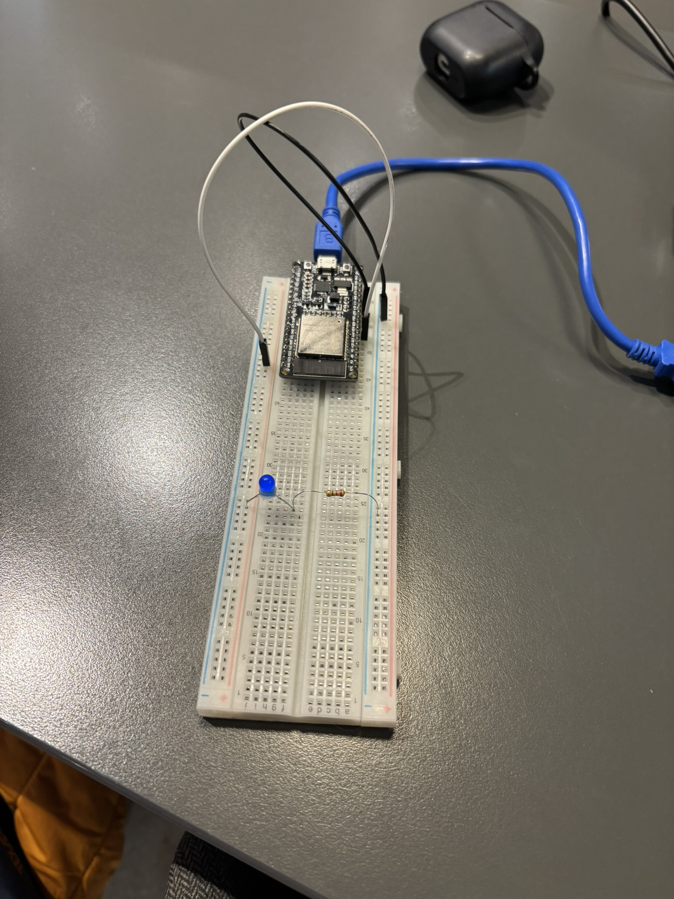
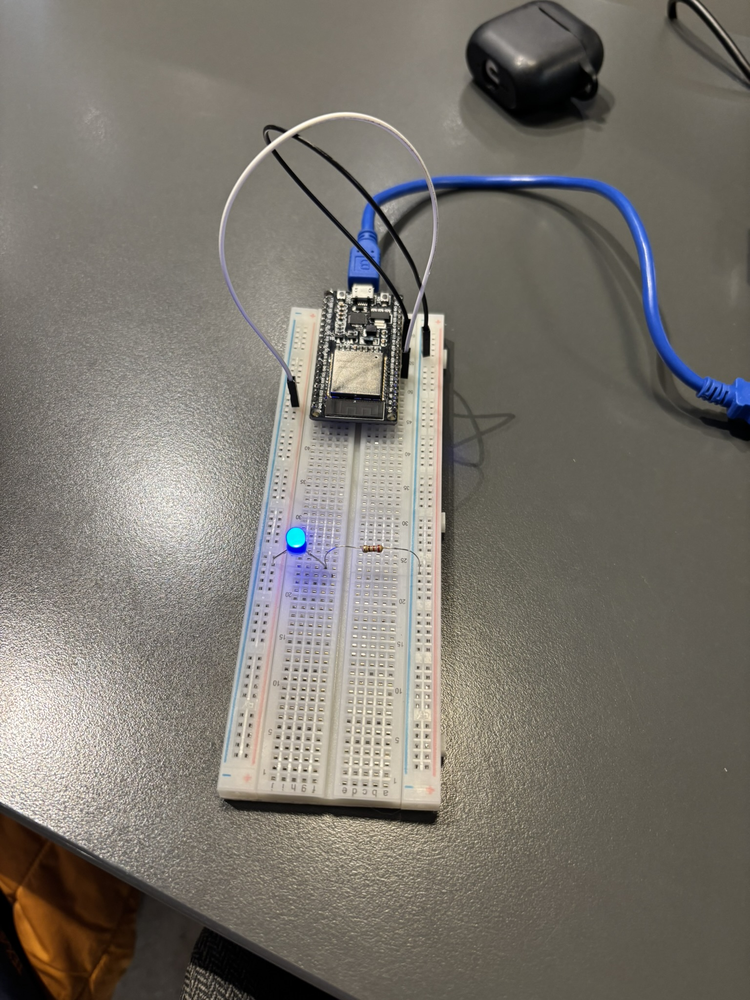

# 03 — LEDC Donanım PWM ile LED Parlaklık ve Nefes Alma Efekti

Bu proje, **ESP-WROOM-32** mikrodenetleyicisinin dahili **LEDC (LED Control / PWM)** çevrebirimini kullanarak işlemciye ek yük bindirmeden donanımsal darbe genişlik modülasyonu (**Pulse Width Modulation - PWM**) üretmeyi ve harici bir LED üzerinde pürüzsüz bir nefes alma (**Breathe / Fade**) efekti oluşturmayı hedefler.

---

## 🎯 Hedefler ve Öğrenilen Kavramlar

1. **Donanımsal PWM vs Yazılımsal Bit-Banging:**
   - Yazılımsal döngülerle (`delay`) LED yakıp söndürmek CPU'yu gereksiz kilitler.
   - ESP32'nin **LEDC** donanımı, saat kaynağından aldığı frekansla darbe üretimini bağımsız donanım zamanlayıcılarıyla yürütür (CPU kullanımı %0'a yakındır).
2. **LEDC Zamanlayıcı (Timer) Yapılandırması (`ledc_timer_config_t`):**
   - **Frekans (`5000 Hz`):** İnsan gözünün algılayamayacağı kadar yüksek, tamamen titreşimsiz bir 5 kHz kare dalga frekansı.
   - **Çözünürlük (`LEDC_TIMER_13_BIT`):** $2^{13} = 8192$ adım ($0$ ile $8191$ arası). Bu yüksek çözünürlük, parlaklık geçişlerinin kademe hissettirmeden ipeksi akmasını sağlar.
3. **LEDC Kanal (Channel) Yapılandırması (`ledc_channel_config_t`):**
   - Zamanlayıcıyı hedef GPIO pinine (**GPIO 25**) ve ilgili PWM kanalına (**Kanal 0**) bağlama.
4. **Görev Döngüsü (Duty Cycle) Yönetimi:**
   - `ledc_set_duty(mod, kanal, duty)`: Yeni parlaklık değerini tampona yazar.
   - `ledc_update_duty(mod, kanal)`: Değeri anında donanımsal çıkışa yansıtır.
   - İki döngü (Fade In ve Fade Out) arasında küçük `vTaskDelay` süreleri verilerek insan nefes alışveriş ritmi modellenir.

---

## 🧰 Donanım Listesi

| Bileşen | Miktar | Açıklama |
| :--- | :---: | :--- |
| **ESP-WROOM-32** | 1 | Geliştirme Kartı |
| **Harici LED** | 1 | Durum Göstergesi (Mavi / Kırmızı) |
| **Direnç** | 1 | `220Ω` veya `330Ω` Akım Sınırlama Direnci |
| **Breadboard** | 1 | Devre montajı için |

---

## 🔌 Pin Bağlantı Tablosu

| Donanım Pini | ESP-WROOM-32 Pini | İşlev / Donanım Kanalı | Not |
| :--- | :--- | :--- | :--- |
| **LED Anot (+)** | **GPIO 25 (G25)** | `LEDC_CHANNEL_0` (Donanımsal PWM) | LED uzun bacak |
| **LED Katot (-)** | Direnç üzerinden **GND** | Ortak Toprak Hattı | Direnç kısa bacağa seri bağlıdır |

---

## 📐 Devre Şeması

```text
       ESP-WROOM-32
     +---------------+
     |               |
     |       GPIO 25 |-------> [LED Anot (+ / Uzun Bacak)]
     | (LEDC PWM Out)|             |
     |               |         [LED Katot (- / Kısa Bacak)]
     |               |             |
     |               |         [220Ω / 330Ω Direnç]
     |               |             |
     |           GND |<------------+
     +---------------+
```

---

## 💻 Kaynak Kod (`main/main.c`)

```c
#include <stdio.h>
#include "freertos/FreeRTOS.h"
#include "freertos/task.h"
#include "driver/ledc.h"
#include "driver/gpio.h"
#include "esp_err.h"
#include "esp_log.h"

#define LEDC_OUTPUT_IO          GPIO_NUM_25
#define LEDC_MODE               LEDC_LOW_SPEED_MODE
#define LEDC_CHANNEL            LEDC_CHANNEL_0
#define LEDC_TIMER              LEDC_TIMER_0
#define LEDC_DUTY_RES           LEDC_TIMER_13_BIT   // 13-bit: Duty değeri 0 ile 8191 arası
#define LEDC_FREQUENCY          (5000)              // 5 kHz PWM frekansı

static const char *TAG = "LEDC_BREATHE";

void app_main(void)
{
    ESP_LOGI(TAG, "ESP32 LEDC Donanım PWM Nefes Alma Projesi Başlatılıyor...");

    // 1. ADIM: Donanım PWM Zamanlayıcısını Yapılandırma (Timer Configuration)
    ledc_timer_config_t timer_cfg = {
        .speed_mode = LEDC_MODE,
        .timer_num = LEDC_TIMER,
        .duty_resolution = LEDC_DUTY_RES,
        .freq_hz = LEDC_FREQUENCY,
        .clk_cfg = LEDC_AUTO_CLK,
    };
    ledc_timer_config(&timer_cfg);

    // 2. ADIM: Donanım PWM Kanalını Yapılandırma (Channel Configuration)
    ledc_channel_config_t channel_cfg = {
        .gpio_num = LEDC_OUTPUT_IO,
        .speed_mode = LEDC_MODE,
        .channel = LEDC_CHANNEL,
        .timer_sel = LEDC_TIMER,
        .duty = 0,
        .hpoint = 0,
    };
    ledc_channel_config(&channel_cfg);

    // 3. ADIM: Ana Çalışma Döngüsü (Nefes Alma / Breathe Efekti)
    while (1) {
        // Fade In: 0'dan 8191'e kadar parlaklığı artır
        for (int duty = 0; duty <= 8191; duty += 50) {
            ledc_set_duty(LEDC_MODE, LEDC_CHANNEL, duty);
            ledc_update_duty(LEDC_MODE, LEDC_CHANNEL);
            vTaskDelay(pdMS_TO_TICKS(10));
        }

        // Fade Out: 8191'den 0'a kadar parlaklığı azalt
        for (int duty = 8191; duty >= 0; duty -= 50) {
            ledc_set_duty(LEDC_MODE, LEDC_CHANNEL, duty);
            ledc_update_duty(LEDC_MODE, LEDC_CHANNEL);
            vTaskDelay(pdMS_TO_TICKS(10));
        }
    }
}
```

---

## 🔨 Derleme ve Karta Yükleme

```powershell
# 1. Ortamı aktifleştirin
$env:IDF_TOOLS_PATH = "C:\Espressif"
. C:\esp\v6.1\esp-idf\export.ps1

# 2. Proje dizinine geçin
cd 01_ESP_WROOM_32/01_beginner/03_ledc_pwm_breathe_led

# 3. Derleyin ve flaşlayın
idf.py -p COM4 build flash monitor
```

---

## 📸 Uygulama Görselleri

| Sönük Durum (Min Parlaklık) | Tam Parlaklık (Max Parlaklık) |
| :---: | :---: |
|  |  |
