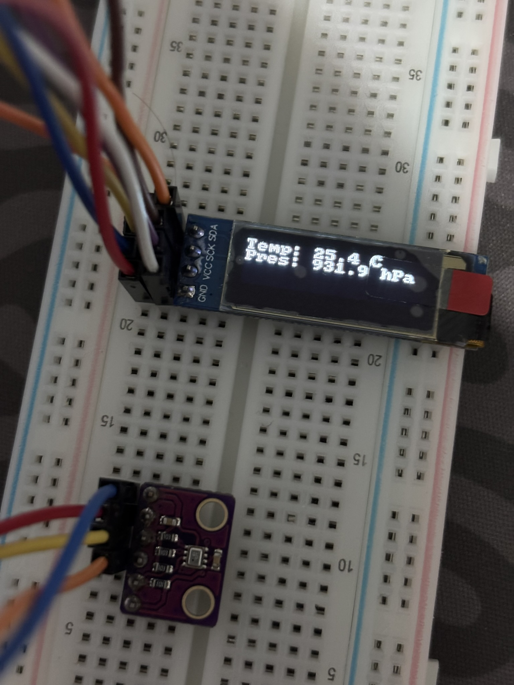

# 05 — I2C Sensör Okuma ve OLED Dijital Termometre/Barometre (GY-BMP280 & SSD1306)

Bu proje, **ESP-WROOM-32** mikrodenetleyicisinin tek bir donanımsal **I2C Master (`I2C_NUM_0`)** veri yolu üzerinde birden fazla cihazı (**Multi-Slave I2C Bus**) paralel olarak yönetmeyi; `0x76` adresli **GY-BMP280** sensöründen gerçek zamanlı sıcaklık (`°C`) ve atmosferik basınç (`hPa`) verilerini okuyarak `0x3C` adresli **0.91" 128x32 SSD1306 OLED** ekrana yazdırmayı hedefler.

---

## 🎯 Hedefler ve Öğrenilen Kavramlar

1. **Çoklu Cihazlı (Multi-Slave) I2C Veri Yolu Mimarisi:**
   - Tek bir `i2c_master_bus_handle_t` (`GPIO 16` SDA ve `GPIO 17` SCL) oluşturarak aynı iki kablo üzerine hem **SSD1306 OLED (`0x3C`)** hem de **GY-BMP280 (`0x76`)** cihazlarını paralel bağlama.
2. **GY-BMP280 Sensör Kalibrasyonu ve Ölçümü:**
   - Sensörün dahili ROM belleğindeki fabrika kalibrasyon katsayılarını (`dig_T1..T3`, `dig_P1..P9`) okuma ve 20-bitlik ham ADC verisini kompanze edilmiş sıcaklık (`°C`) ile basınç (`Pa`) değerlerine dönüştürme.
3. **Birim Dönüşümü ve Karakter Dizisi Formatlama (`snprintf`):**
   - Pascal (`Pa`) cinsinden okunan basıncı `100.0f`'e bölerek meteorolojik standart olan Hektopaskal (`hPa`) birimine çevirme.
   - `float` türündeki sensör verilerini `snprintf` ile güvenli şekilde 16 karakterlik OLED satır tamponuna (`char buf[17]`) formatlayıp ekrana basma.

---

## 🧰 Donanım Listesi

| Bileşen | Miktar | Açıklama |
| :--- | :---: | :--- |
| **ESP-WROOM-32** | 1 | Geliştirme Kartı |
| **GY-BMP280** | 1 | Dijital Barometrik Basınç ve Sıcaklık Sensörü (I2C Adresi: `0x76`) |
| **0.91" OLED Ekran** | 1 | `128x32` Piksel, I2C Arayüzlü (`SSD1306`, Adres: `0x3C`) |
| **Breadboard & Jumper** | 1 Set | Ortak güç (`3.3V`/`GND`) ve ortak I2C (`SDA`/`SCL`) bağlantıları için |

---

## 🔌 Pin Bağlantı Tablosu

| Modül / Sensör Pini | ESP-WROOM-32 Pini | İşlev / Donanım Kanalı | Not |
| :--- | :--- | :--- | :--- |
| **OLED VCC** & **BMP280 VCC** | **3V3** | Güç Beslemesi (`3.3V`) | Breadboard `+` hattında ortak |
| **OLED GND** & **BMP280 GND** | **GND** | Toprak Hattı | Breadboard `-` hattında ortak |
| **OLED SDA** & **BMP280 SDA** | **GPIO 16 (D16)** | `I2C_NUM_0` Veri Hattı (`SDA`) | İki cihaz paralel bağlı |
| **OLED SCK** & **BMP280 SCL** | **GPIO 17 (D17)** | `I2C_NUM_0` Saat Hattı (`SCL`) | İki cihaz paralel bağlı |

---

## 📐 Devre Şeması

```text
        ESP-WROOM-32                        Ortak I2C Veri Yolu
      +---------------+
      |           3V3 |──────┬────────────> [OLED VCC]
      |               |      └────────────> [GY-BMP280 VCC]
      |               |
      |           GND |──────┬────────────> [OLED GND]
      |               |      └────────────> [GY-BMP280 GND]
      |               |
      |  GPIO 16 (SDA)| <────┬────────────> [OLED SDA]      (Adres: 0x3C)
      |               |      └────────────> [GY-BMP280 SDA] (Adres: 0x76)
      |               |
      |  GPIO 17 (SCL)| ─────┬────────────> [OLED SCK]
      |               |      └────────────> [GY-BMP280 SCL]
      +---------------+
```

---

## 💻 Kaynak Kod (`main/main.c`)

```c
#include <stdio.h>
#include <string.h>
#include "freertos/FreeRTOS.h"
#include "freertos/task.h"
#include "driver/i2c_master.h"
#include "driver/gpio.h"
#include "esp_err.h"
#include "esp_log.h"
#include "ssd1306.h"
#include "bmp280.h"

#define I2C_SDA_PIN GPIO_NUM_16
#define I2C_SCK_PIN GPIO_NUM_17

void app_main(void)
{
    i2c_master_bus_config_t i2c_bus_cfg = {
        .clk_source = I2C_CLK_SRC_DEFAULT,
        .i2c_port = I2C_NUM_0,
        .scl_io_num = I2C_SCK_PIN,
        .sda_io_num = I2C_SDA_PIN,
        .glitch_ignore_cnt = 7,
        .flags.enable_internal_pullup = true,
    };
    i2c_master_bus_handle_t bus_hdl;
    ESP_ERROR_CHECK(i2c_new_master_bus(&i2c_bus_cfg, &bus_hdl));

    ssd1306_config_t dev_cfg = I2C_SSD1306_128x32_CONFIG_DEFAULT;
    ssd1306_handle_t dev_hdl;
    ESP_ERROR_CHECK(ssd1306_init(bus_hdl, &dev_cfg, &dev_hdl));

    bmp280_config_t bmp_cfg = I2C_BMP280_CONFIG_DEFAULT;
    bmp_cfg.i2c_address = I2C_BMP280_DEV_ADDR_LO;
    bmp280_handle_t bmp_hdl;
    ESP_ERROR_CHECK(bmp280_init(bus_hdl, &bmp_cfg, &bmp_hdl));

    ssd1306_clear_display(dev_hdl, false);
    ssd1306_set_contrast(dev_hdl, 0xff);

    while (1) {
        
        float temp, pres;
        char buf[17];

        bmp280_get_measurements(bmp_hdl, &temp, &pres);

        snprintf(buf, sizeof(buf), "Temp: %.1f C", temp);
        ssd1306_display_text(dev_hdl, 0, buf, false);
        snprintf(buf, sizeof(buf), "Pres: %.1f hPa", pres / 100.0f);
        ssd1306_display_text(dev_hdl, 1, buf, false);

        vTaskDelay(pdMS_TO_TICKS(1000));
    }
}
```

---

## 🔨 Derleme ve Karta Yükleme

```powershell
# 1. ESP-IDF ortamını aktifleştirin
$env:IDF_TOOLS_PATH = "C:\Espressif"
. C:\esp\v6.1\esp-idf\export.ps1

# 2. Proje dizinine geçin
cd 01_ESP_WROOM_32/02_intermediate/05_i2c_bmp280_oled_thermometer

# 3. Derleyin ve karta yükleyin
idf.py -p COM4 build flash monitor
```

---

## 📸 Uygulama Görseli


