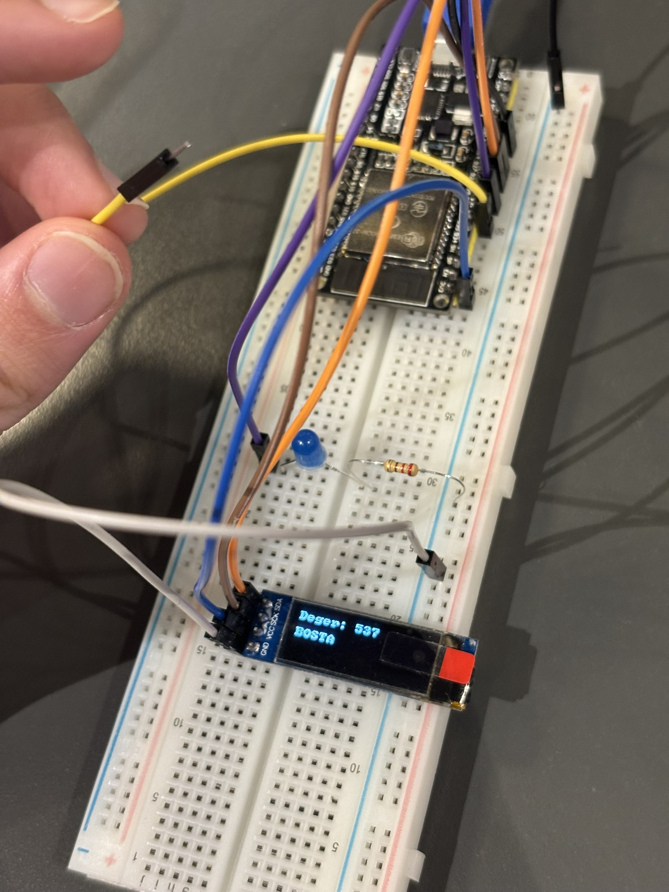
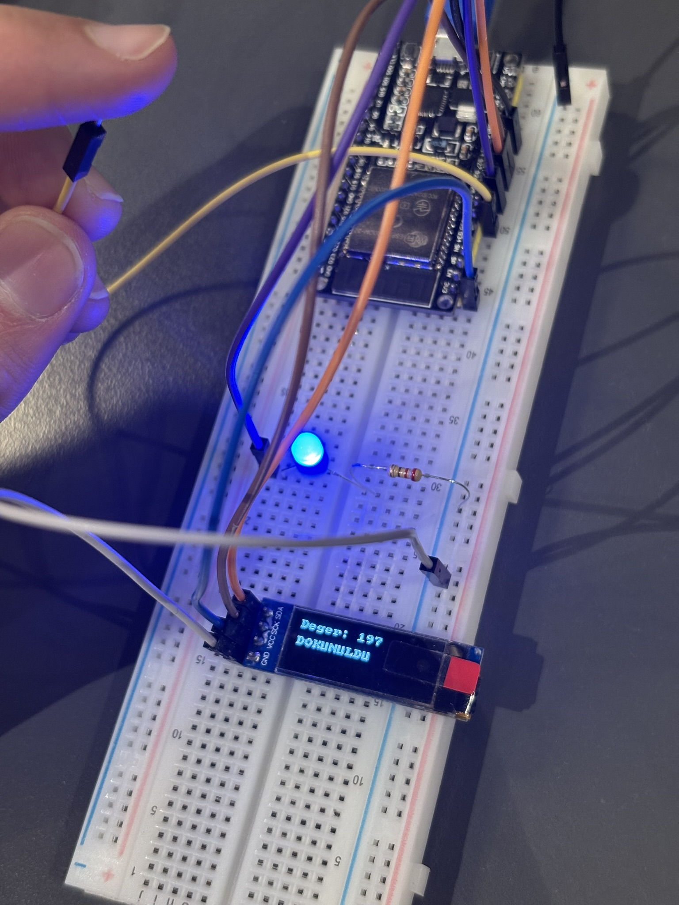

# 06 — Kapasitif Dokunmatik Sensör, LED ve Canlı OLED Gösterge Paneli

Bu proje, **ESP-WROOM-32** mikrodenetleyicisinin dahili kapasitif dokunmatik sensör birimini (`TOUCH_PAD_NUM9` / `GPIO 32`), dijital GPIO çıkışını (`GPIO 25`) ve donanımsal I2C Master (`GPIO 27` SDA, `GPIO 14` SCL) üzerinden **0.91" 128x32 SSD1306 OLED** ekranını birleştirerek; parmak temasını ve anlık kapasitans değerini hem LED üzerinde hem de OLED ekranda gerçek zamanlı göstermeyi hedefler.

---

## 🎯 Hedefler ve Öğrenilen Kavramlar

1. **Çoklu Çevrebirim Entegrasyonu (Touch + GPIO + I2C):**
   - ESP32'nin sol sütunundaki pinleri (`GPIO 32`, `GPIO 25`, `GPIO 27`, `GPIO 14`) tek bir breadboard diziliminde birlikte kullanarak hem analog/kapasitif okuma hem dijital LED sürüşü hem de I2C ekran haberleşmesini eşzamanlı yürütme.
2. **Dinamik Sayısal Formatlama (`%-4u`) ve Karakter Temizliği:**
   - `snprintf(buf, sizeof(buf), "Deger: %-4u", touch_val)` ile 3 basamaklı (`~600`) değerden 2-3 basamaklı (`~160`) değere düşüldüğünde ekranda eski basamak kalıntılarının kalmasını sola dayalı sabit genişlikli formatlama ile önleme.
   - `"DOKUNULDU"` (9 karakter) ve `"BOSTA    "` (5 karakter + 4 boşluk) metinleriyle tüm ekranı silmeden (`clear_display` çağırmadan) titreşimsiz satır güncellemesi yapma.

---

## 🧰 Donanım Listesi

| Bileşen | Miktar | Açıklama |
| :--- | :---: | :--- |
| **ESP-WROOM-32** | 1 | Geliştirme Kartı |
| **0.91" OLED Ekran** | 1 | `128x32` Piksel, I2C Arayüzlü (`SSD1306`, Adres: `0x3C`) |
| **Harici LED** | 1 | Durum Göstergesi |
| **Direnç** | 1 | `220Ω` veya `330Ω` Akım Sınırlama Direnci |
| **Jumper Kablo** | 1 Set | Dokunmatik prob ve I2C/LED bağlantıları için |

---

## 🔌 Pin Bağlantı Tablosu

| Bileşen / Pin | ESP-WROOM-32 Pini | İşlev / Donanım Kanalı | Not |
| :--- | :--- | :--- | :--- |
| **Dokunmatik Tel** | **GPIO 32 (D32)** | `TOUCH_PAD_NUM9` (T9) | Diğer ucu boşta (dokunmatik prob) |
| **LED Anot (+)** | **GPIO 25 (D25)** | Dijital Çıkış (`GPIO_MODE_OUTPUT`) | Uzun bacak |
| **LED Katot (-)** | **GND** (`220Ω` direnç ile) | Toprak Hattı | Kısa bacak seri direnç üzerinden GND'ye |
| **OLED SDA** | **GPIO 27 (D27)** | `I2C_NUM_0` Veri Hattı (`SDA`) | Sol sütun GPIO Matrix yönlendirmesi |
| **OLED SCK / SCL** | **GPIO 14 (D14)** | `I2C_NUM_0` Saat Hattı (`SCL`) | Sol sütun GPIO Matrix yönlendirmesi |
| **OLED VCC & GND** | **3V3 & GND** | Güç Beslemesi (`3.3V`) | Ortak besleme hattı |

---

## 📐 Devre Şeması

```text
        ESP-WROOM-32 (Sol Sütun)
      +------------------+
      |     GPIO 32 (D32)|═══════> [ Boşta Jumper Kablo (Dokunmatik Prob) ]
      |                  |
      |     GPIO 25 (D25)|───────> [ LED (+) ] ──> [ 220Ω Direnç ] ──> GND
      |                  |
      |     GPIO 27 (D27)|<──────> [ OLED SDA ]
      |     GPIO 14 (D14)|───────> [ OLED SCK ]
      |              3V3 |───────> [ OLED VCC ]
      |              GND |───────> [ OLED GND ]
      +------------------+
```

---

## 💻 Kaynak Kod (`main/main.c`)

```c
#include <stdio.h>
#include <string.h>
#include "freertos/FreeRTOS.h"
#include "freertos/task.h"
#include "driver/gpio.h"
#include "driver/touch_pad.h"
#include "driver/i2c_master.h"
#include "esp_err.h"
#include "esp_log.h"
#include "ssd1306.h"

#define TOUCH_PAD_CHANNEL TOUCH_PAD_NUM9
#define LED_GPIO_PIN GPIO_NUM_25

#define I2C_SDA_PIN GPIO_NUM_27
#define I2C_SCK_PIN GPIO_NUM_14

static const char *TAG = "TOUCH_LED";

void app_main(void)
{
    ESP_LOGI(TAG, "ESP32 Kapasitif Dokunmatik Sensör & LED Bar Projesi Başlatılıyor...");

    touch_pad_init();
    touch_pad_config(TOUCH_PAD_CHANNEL, 0);
    gpio_set_direction(LED_GPIO_PIN, GPIO_MODE_OUTPUT);

    i2c_master_bus_config_t i2c_bus_cfg = {
        .clk_source = I2C_CLK_SRC_DEFAULT,
        .i2c_port = I2C_NUM_0,
        .scl_io_num = I2C_SCK_PIN,
        .sda_io_num = I2C_SDA_PIN,
        .glitch_ignore_cnt = 7,
        .flags.enable_internal_pullup = true,
    };
    i2c_master_bus_handle_t bus_hdl;
    ESP_ERROR_CHECK(i2c_new_master_bus(&i2c_bus_cfg, &bus_hdl));

    ssd1306_config_t dev_cfg = I2C_SSD1306_128x32_CONFIG_DEFAULT;
    ssd1306_handle_t dev_hdl;
    ESP_ERROR_CHECK(ssd1306_init(bus_hdl, &dev_cfg, &dev_hdl));

    ssd1306_clear_display(dev_hdl, false);
    ssd1306_set_contrast(dev_hdl, 0xff); // Maksimum parlaklık

    while (1) {
        uint16_t touch_val = 0;
        char buf[17];

        touch_pad_read(TOUCH_PAD_CHANNEL, &touch_val);
        ESP_LOGI(TAG, "Dokunma Degeri: %u", touch_val);

        snprintf(buf, sizeof(buf), "Deger: %-4u", touch_val);
        ssd1306_display_text(dev_hdl, 0, buf, false);

        if (touch_val < 500) {
            gpio_set_level(LED_GPIO_PIN, 1);
            ssd1306_display_text(dev_hdl, 2, "DOKUNULDU", false);
        } else {
            gpio_set_level(LED_GPIO_PIN, 0);
            ssd1306_display_text(dev_hdl, 2, "BOSTA    ", false);
        }

        vTaskDelay(pdMS_TO_TICKS(100));
    }
}
```

---

## 🔨 Derleme ve Karta Yükleme

```powershell
# 1. ESP-IDF ortamını aktifleştirin
$env:IDF_TOOLS_PATH = "C:\Espressif"
. C:\esp\v6.1\esp-idf\export.ps1

# 2. Proje dizinine geçin
cd 01_ESP_WROOM_32/02_intermediate/06_touch_led_oled_monitor

# 3. Derleyin ve karta yükleyin
idf.py -p COM4 build flash monitor
```

---

## 📸 Uygulama Görselleri

| Boşta (`BOSTA` — LED Sönük) | Dokunulduğunda (`DOKUNULDU` — LED Yanık) |
| :---: | :---: |
|  |  |
