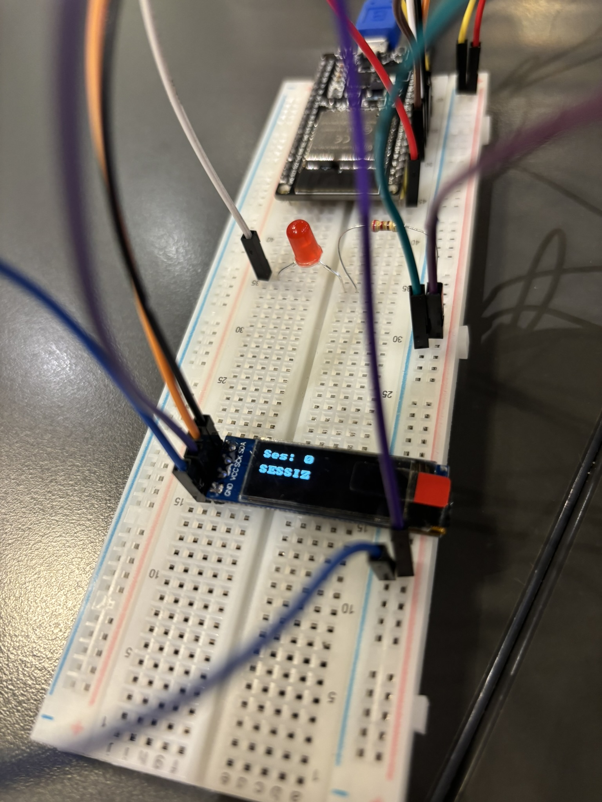
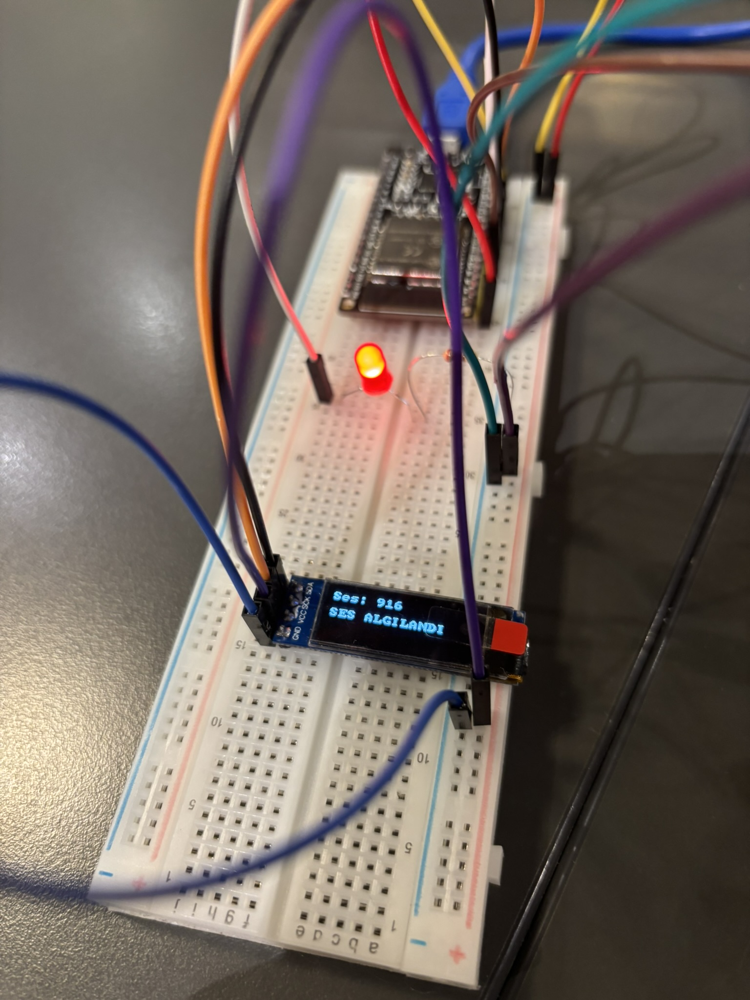

# 07 — ESP32 ADC ile Analog Ses Seviyesi (VU Meter) ve Gürültü Algılayıcı

Bu proje, **ESP-WROOM-32** mikrodenetleyicisinin **12-bit SAR ADC (`adc_oneshot`)** birimini kullanarak **MAX4466** kazançlı mikrofon amfisinden analog ses dalgalarını yüksek hızda örneklemeyi, tepe-tepe (*Peak-to-Peak*) ses genliğini hesaplamayı ve ses şiddetini hem **0.91" I2C OLED** ekranda hem de durum LED'i üzerinde gerçek zamanlı göstermeyi hedefler.

---

## 🎯 Hedefler ve Öğrenilen Kavramlar

1. **ESP32 12-Bit ADC (`esp_adc/adc_oneshot.h`) Yapılandırması:**
   - `ADC_UNIT_1` ve `ADC_CHANNEL_4` (`GPIO 32`) kanalını `12-bit` çözünürlük (`0..4095`) ve `ADC_ATTEN_DB_12` (`0V - 3.3V` tam voltaj aralığı) ile yapılandırma.
2. **AC Ses Dalgası ve Tepe-Tepe (Peak-to-Peak) Genlik Ölçümü:**
   - `MAX4466` mikrofon amfisinin sessiz durumda $V_{CC}/2 \approx 1.65\text{V}$ (`~2048`) DC ofset üzerinde durduğunu kavrama.
   - Anlık tek okuma yerine `500` ardışık hızlı örnekleme yaparak pencere içindeki `max_val - min_val` farkını (gerçek akustik genliği) yakalama.
3. **Eşik Algılama ve Görsel Tutma Süresi (Hold Time):**
   - Ses şiddeti belirlenen eşiği (`> 900`) aştığında LED'i yakıp OLED ekranda `"SES ALGILANDI"` uyarısını `300 ms` boyunca görünür tutma.

---

## 🧰 Donanım Listesi

| Bileşen | Miktar | Açıklama |
| :--- | :---: | :--- |
| **ESP-WROOM-32** | 1 | Geliştirme Kartı |
| **MAX4466 Mikrofon Amfisi** | 1 | Ayarlanabilir Kazançlı Analog Elektret Mikrofon Modülü |
| **0.91" OLED Ekran** | 1 | `128x32` Piksel, I2C Arayüzlü (`SSD1306`, Adres: `0x3C`) |
| **Harici LED & Direnç** | 1 | Ses Eşik Uyarı Göstergesi (`220Ω` direnç ile) |
| **Breadboard & Jumper** | 1 Set | Devre bağlantıları için |

---

## 🔌 Pin Bağlantı Tablosu

| Modül / Bileşen Pini | ESP-WROOM-32 Pini | İşlev / Donanım Kanalı | Not |
| :--- | :--- | :--- | :--- |
| **MAX4466 OUT** | **GPIO 32 (D32)** | `ADC1_CHANNEL_4` (12-Bit Analog Giriş) | Analog ses çıkışı |
| **MAX4466 VCC & GND** | **3V3 & GND** | Güç Beslemesi (`3.3V`) | Gürültüsüz 3.3V hattı |
| **LED Anot (+)** | **GPIO 25 (D25)** | Dijital Çıkış (`GPIO_MODE_OUTPUT`) | Ses uyarı LED'i |
| **LED Katot (-)** | **GND** (`220Ω` direnç ile) | Toprak Hattı | Akım sınırlama direnci |
| **OLED SDA** | **GPIO 27 (D27)** | `I2C_NUM_0` Veri Hattı (`SDA`) | Sol sütun I2C yönlendirmesi |
| **OLED SCK / SCL** | **GPIO 14 (D14)** | `I2C_NUM_0` Saat Hattı (`SCL`) | Sol sütun I2C yönlendirmesi |
| **OLED VCC & GND** | **3V3 & GND** | Güç Beslemesi (`3.3V`) | Ortak güç şeridi |

---

## 📐 Devre Şeması

```text
        ESP-WROOM-32 (Sol Sütun)
      +------------------+
      |     GPIO 32 (D32)|<─────── [ MAX4466 OUT ] (ADC1_CH4)
      |                  |
      |     GPIO 25 (D25)|───────> [ LED (+) ] ──> [ 220Ω Direnç ] ──> GND
      |                  |
      |     GPIO 27 (D27)|<──────> [ OLED SDA ]
      |     GPIO 14 (D14)|───────> [ OLED SCK ]
      |                  |
      |              3V3 |───────> [ MAX4466 VCC + OLED VCC ]
      |              GND |───────> [ MAX4466 GND + OLED GND ]
      +------------------+
```

---

## 💻 Kaynak Kod (`main/main.c`)

```c
#include <stdio.h>
#include <string.h>
#include "freertos/FreeRTOS.h"
#include "freertos/task.h"
#include "esp_adc/adc_oneshot.h"
#include "driver/gpio.h"
#include "driver/i2c_master.h"
#include "esp_err.h"
#include "esp_log.h"
#include "ssd1306.h"

#define MIC_ADC_CHANNEL ADC_CHANNEL_4
#define LED_GPIO_PIN GPIO_NUM_25
#define I2C_SDA_PIN GPIO_NUM_27
#define I2C_SCK_PIN GPIO_NUM_14

void app_main(void)
{
    gpio_set_direction(LED_GPIO_PIN, GPIO_MODE_OUTPUT);

    adc_oneshot_unit_handle_t adc_hdl;
    adc_oneshot_unit_init_cfg_t init_cfg = {
        .unit_id = ADC_UNIT_1,
    };
    ESP_ERROR_CHECK(adc_oneshot_new_unit(&init_cfg, &adc_hdl));

    adc_oneshot_chan_cfg_t chan_cfg = {
        .bitwidth = ADC_BITWIDTH_DEFAULT,
        .atten = ADC_ATTEN_DB_12,
    };
    ESP_ERROR_CHECK(adc_oneshot_config_channel(adc_hdl, MIC_ADC_CHANNEL, &chan_cfg));

    i2c_master_bus_config_t i2c_bus_cfg = {
        .clk_source = I2C_CLK_SRC_DEFAULT,
        .i2c_port = I2C_NUM_0,
        .scl_io_num = I2C_SCK_PIN,
        .sda_io_num = I2C_SDA_PIN,
        .glitch_ignore_cnt = 7,
        .flags.enable_internal_pullup = true,
    };
    i2c_master_bus_handle_t bus_hdl;
    ESP_ERROR_CHECK(i2c_new_master_bus(&i2c_bus_cfg, &bus_hdl));

    ssd1306_config_t dev_cfg = I2C_SSD1306_128x32_CONFIG_DEFAULT;
    ssd1306_handle_t dev_hdl;
    ESP_ERROR_CHECK(ssd1306_init(bus_hdl, &dev_cfg, &dev_hdl));

    ssd1306_clear_display(dev_hdl, false);
    ssd1306_set_contrast(dev_hdl, 0xff);

    while (1) {
        int min_val = 4095;
        int max_val = 0;
        char buf[17];

        for (int i = 0; i < 500; i++) {
            int val = 0;
            adc_oneshot_read(adc_hdl, MIC_ADC_CHANNEL, &val);
            if (val > max_val) max_val = val;
            if (val < min_val) min_val = val;
        }

        int ses_siddeti = max_val - min_val;

        snprintf(buf, sizeof(buf), "Ses: %-4d", ses_siddeti);
        ssd1306_display_text(dev_hdl, 0, buf, false);

        if (ses_siddeti > 900) {
            gpio_set_level(LED_GPIO_PIN, 1);
            ssd1306_display_text(dev_hdl, 2, "SES ALGILANDI", false);
            vTaskDelay(pdMS_TO_TICKS(300));
        } else {
            gpio_set_level(LED_GPIO_PIN, 0);
            ssd1306_display_text(dev_hdl, 2, "SESSIZ       ", false);
            vTaskDelay(pdMS_TO_TICKS(20));
        }
    }
}
```

---

## 🔨 Derleme ve Karta Yükleme

```powershell
# 1. ESP-IDF ortamını aktifleştirin
$env:IDF_TOOLS_PATH = "C:\Espressif"
. C:\esp\v6.1\esp-idf\export.ps1

# 2. Proje dizinine geçin
cd 01_ESP_WROOM_32/02_intermediate/07_adc_microphone_vu_meter

# 3. Derleyin ve karta yükleyin
idf.py -p COM4 build flash monitor
```

---

## 📸 Uygulama Görselleri

| Sessiz Ortam (`SESSIZ` — LED Sönük) | Ses Algılandığında (`SES ALGILANDI` — LED Yanık) |
| :---: | :---: |
|  |  |
