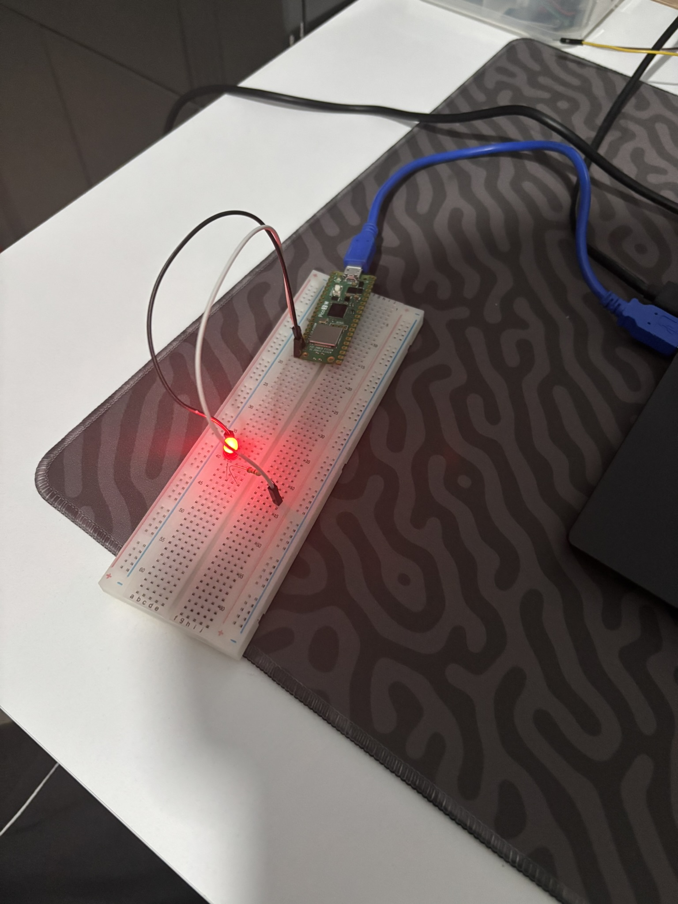
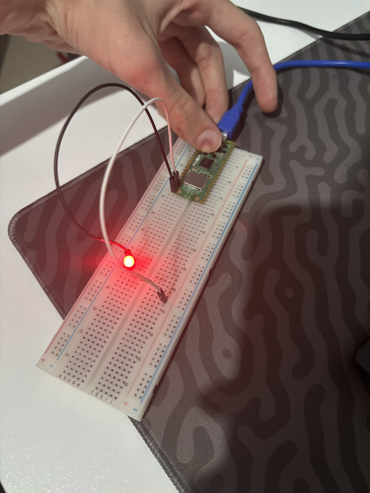
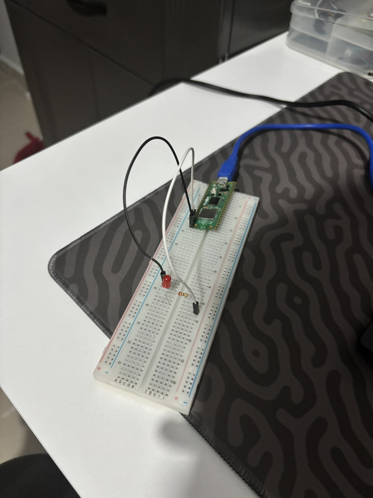

# 01 - Raspberry Pi Pico 2 W: LED Blink ve BOOTSEL Butonu Kontrolü

Bu proje, **Raspberry Pi Pico 2 W (RP2350)** geliştirme kartı için `rp2040:rp2040` derleyici çekirdeğini ve **UF2 / USB-CDC (`COM6`)** yükleme hattını doğrulamak, harici GPIO (`GP15`) üzerinden LED sürmek ve doğrudan QSPI Flash `CS` hattına bağlı olan özel **`BOOTSEL`** butonunu okumak amacıyla geliştirilmiştir.

---

## 🎯 Projenin Amacı ve Öğrenilen Kavramlar

1. **UF2 Bootloader ve Otomatik USB Reset:** İlk yüklemede `BOOTSEL` tuşuyla RP2350 ROM Bootloader (`D: (RP2350)`) sürücüsüne geçişi, sonraki yüklemelerde ise sanal seri port (`COM6`) üzerinden otomatik 1200-bps reset ile kablo sök-tak yapmadan kod yüklemeyi öğrenme.
2. **Pico Pin Geometrisi (Yuvarlak vs. Kare Pedler):** Kart üzerinde `GND` (Toprak) pinlerinin diğer yuvarlak GPIO pedlerinden ayırt edilmesi için **kare (`■`)** bakır pedlerle tasarlandığını öğrenme.
3. **`BOOTSEL` Donanım Mimarisi (ESP32'den Farkı):** ESP32'deki `BOOT` tuşu standart bir GPIO pinine (`GPIO 0`) bağlıyken, Pico 2 W üzerindeki `BOOTSEL` tuşunun doğrudan QSPI Flash bellek çipinin **Chip Select (`CS`)** hattına bağlı olduğunu ve `BOOTSEL` özel değişkeniyle Flash erişimi anlık askıya alınarak okunduğunu kavrama.

---

## 🛠️ Kullanılan Malzemeler

| Malzeme | Adet / Değer | Açıklama |
| :--- | :---: | :--- |
| **Raspberry Pi Pico 2 W** | 1 | RP2350 (Çift ARM Cortex-M33 / Hazard3 RISC-V + CYW43439) |
| **Breadboard** | 1 | Devre kurulum tablası |
| **Kırmızı LED** | 1 | Harici durum göstergesi (`GP15`) |
| **Direnç** | 1 × `220Ω` / `330Ω` | LED akım sınırlama direnci |
| **Jumper Kablo** | 2 × Erkek-Erkek | Pico deliklerinden breadboard'a bağlantı için |

---

## 🔌 Pin Bağlantı Tablosu ve Devre Şeması

| Pico 2 W Pini | Konum / Ped Tipi | Breadboard Noktası | Açıklama |
| :--- | :--- | :--- | :--- |
| **`GP15` (Pin 20)** | Sol en alt köşe (1. delik - Yuvarlak `o`) | `10a` $\rightarrow$ Direnç $\rightarrow$ LED Uzun Bacak (`+`) | Dijital sinyal çıkışı (`3.3V` / `0V`) |
| **`GND` (Pin 18)** | Sol alttan 3. delik (Kare `■`) | `20a` $\rightarrow$ LED Kısa Bacak (`-`) | Ortak toprak (Eksi) hattı |
| **`BOOTSEL`** | Kart üzerindeki beyaz buton | Dahili (QSPI Flash `CS`) | Basıldığında `true`, bırakıldığında `false` döner |

### ASCII Devre Şeması:
```text
      +3.3V / 0V
    (GP15 / Pin 20)
          │
          ├───[ 330Ω Direnç ]───( + Anot )
          │                         │
          │                       [LED]
          │                         │
          │                     ( - Katot )
          │                         │
         GND ───────────────────────┘
      (Pin 18)
```

---

## 💻 Geliştirme Aşamaları ve Kodlar

### Aşama 1: Periyodik LED Blink
`GP15` pinine bağlı harici LED'in `100 ms` aralıklarla yanıp sönmesini sağlayan temel kod:

```cpp
#include <Arduino.h>

#define MY_LED_PIN 15

void setup() {
    pinMode(MY_LED_PIN, OUTPUT);
}

void loop() {
    digitalWrite(MY_LED_PIN, HIGH);
    delay(100);
    digitalWrite(MY_LED_PIN, LOW);
    delay(100);
}
```

### Aşama 2: `BOOTSEL` Butonu ile LED Kontrolü ([`src/main.cpp`](src/main.cpp))
Kart üzerindeki beyaz `BOOTSEL` tuşuna basıldıkça LED'i yakan, bırakıldığında söndüren güncel kod:

```cpp
#include <Arduino.h>

#define MY_LED_PIN 15

void setup() {
    pinMode(MY_LED_PIN, OUTPUT);
}

void loop() {
    if (BOOTSEL) {
        digitalWrite(MY_LED_PIN, HIGH);
    } else {
        digitalWrite(MY_LED_PIN, LOW);
    }
}
```

---

## 🚀 Derleme ve Karta Yükleme Komutları (`arduino-cli`)

Ana proje dizinindeyken (`embedded-systems-lab/`):

```powershell
# İlk kez BOOTSEL (UF2) modunda yüklerken:
arduino-cli compile -u -p UF2_Board --fqbn rp2040:rp2040:rpipico2w 02_RPi_Pico_2_W/01_beginner/01_led_blink_cyw43_and_gpio/src

# Sonraki yüklemelerde doğrudan COM6 portu üzerinden:
arduino-cli compile -u -p COM6 --fqbn rp2040:rp2040:rpipico2w 02_RPi_Pico_2_W/01_beginner/01_led_blink_cyw43_and_gpio/src
```

---

## 📸 Uygulama Görselleri

| Aşama 1: LED Blink (`delay.JPEG`) | Aşama 2: `BOOTSEL` Basılı (`button_press.JPEG`) | Aşama 2: `BOOTSEL` Bırakıldı (`button_release.JPEG`) |
| :---: | :---: | :---: |
|  |  |  |


