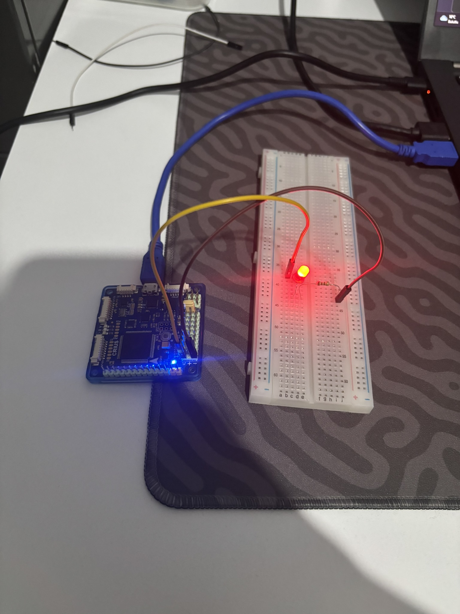
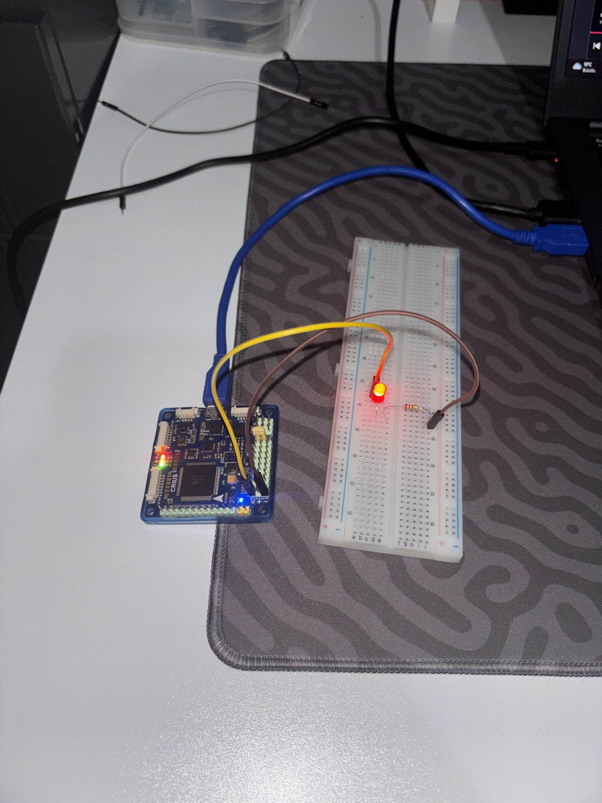

# 01 - CRIUS ALL IN ONE PRO (ATmega2560): Harici ve Dahili Durum LED'leri Kontrolü

Bu proje, **CRIUS ALL IN ONE PRO v1.1 (8-Bit AVR ATmega2560)** uçuş kontrolcüsü kartı için `arduino:avr` derleyici/yükleyici (`COM7`) zincirini doğrulamak, kartın servo/motor çıkış pin mimarisini (`S / +5V / GND`) öğrenmek ve hem breadboard üzerindeki harici LED'i (`D2`) hem de kart üzerindeki 3 yerleşik uçuş durum LED'ini (`Pin 13`, `Pin 30`, `Pin 31`) senkron olarak sürmek amacıyla geliştirilmiştir.

---

## 🎯 Projenin Amacı ve Öğrenilen Kavramlar

1. **8-Bit AVR Bellek Verimliliği:** 32-bit RTOS tabanlı kartlarda (`ESP32` ~257 KB, `Pico 2 W` ~309 KB) yüzlerce kilobayt yer kaplayan temel bir Blink uygulamasının, 8-bit `ATmega2560` mimarisinde yalnızca **1.6 KB Flash (`%0`)** ve **9 Byte SRAM** tükettiğini gözlemleme.
2. **Uçuş Kontrolcüsü 3'lü Pin Mimarisi (`S / + / -`):** Standart geliştirme kartlarından farklı olarak uçuş kontrolcülerinde her dijital çıkışın 3'lü dikey grup halinde (**İç sıra: Sinyal**, **Orta sıra: +5V**, **Dış sıra: GND**) dizildiğini öğrenme.
3. **Yerleşik Durum LED'leri (`PB7`, `PC6`, `PC7`):** Kart üzerinde fiziksel kullanıcı butonu bulunmadığını (sadece donanımsal `RESET` tuşu olduğunu), bunun yerine uçuş modlarını bildiren 3 adet yerleşik LED (`Pin 13 / PB7`, `Pin 30 / PC7`, `Pin 31 / PC6`) bulunduğunu kavrama.

---

## 🛠️ Kullanılan Malzemeler

| Malzeme | Adet / Değer | Açıklama |
| :--- | :---: | :--- |
| **CRIUS ALL IN ONE PRO** | 1 | 8-Bit AVR `ATmega2560` (16 MHz, 256 KB Flash, 8 KB SRAM) |
| **Breadboard** | 1 | Devre kurulum tablası |
| **Kırmızı LED** | 1 | Harici durum göstergesi (`D2`) |
| **Direnç** | 1 × `220Ω` / `330Ω` | LED akım sınırlama direnci |
| **Jumper Kablo** | 2 × Dişi-Erkek | CRIUS `D2` ve `GND` pinlerini breadboard'a taşımak için |

---

## 🔌 Pin Bağlantı Tablosu ve Devre Şeması

| CRIUS Pini (AVR Portu) | Konum / Sıra | Bağlantı Noktası | Açıklama |
| :--- | :--- | :--- | :--- |
| **`D2` (`PE4`)** | `D2` Sütunu - En İç Sıra (`S`) | `10a` $\rightarrow$ Direnç $\rightarrow$ LED Uzun Bacak (`+`) | Harici LED dijital sinyal çıkışı (`5V` / `0V`) |
| **`GND`** | `D2` Sütunu - En Dış Sıra (`-`) | `20a` $\rightarrow$ LED Kısa Bacak (`-`) | Ortak toprak (Eksi) hattı |
| **`Pin 13` (`PB7`)** | Kart Üzerinde (Yerleşik) | Dahili Durum LED'i A | Yerleşik uçuş durum göstergesi 1 |
| **`Pin 30` (`PC7`)** | Kart Üzerinde (Yerleşik) | Dahili Durum LED'i C | Yerleşik uçuş durum göstergesi 2 |
| **`Pin 31` (`PC6`)** | Kart Üzerinde (Yerleşik) | Dahili Durum LED'i B | Yerleşik uçuş durum göstergesi 3 |

### ASCII Devre Şeması:
```text
       +5V / 0V
     (Pin D2 / PE4)
          │
          ├───[ 330Ω Direnç ]───( + Anot )
          │                         │
          │                       [LED]
          │                         │
          │                     ( - Katot )
          │                         │
         GND ───────────────────────┘
```

---

## 💻 Geliştirme Aşamaları ve Kodlar

### Aşama 1: Tekil Harici LED Blink (`D2`)
Sadece breadboard üzerindeki harici LED'i `100 ms` aralıklarla yakıp söndüren ilk test kodu:

```cpp
#include <Arduino.h>

#define MY_LED_PIN 2

void setup() {
    pinMode(MY_LED_PIN, OUTPUT);
}

void loop() {
    digitalWrite(MY_LED_PIN, HIGH);
    delay(100);
    digitalWrite(MY_LED_PIN, LOW);
    delay(100);
}
```

### Aşama 2: Harici LED (`D2`) + 3 Yerleşik Durum LED'i (`13, 30, 31`) Senkron Kontrolü ([`src/main.cpp`](src/main.cpp))
Hem breadboard'daki LED'i hem de CRIUS üzerindeki 3 yerleşik LED'i aynı anda yakıp söndüren güncel kod:

```cpp
#include <Arduino.h>

void setup() {
    pinMode(2, OUTPUT);
    pinMode(13, OUTPUT);
    pinMode(30, OUTPUT);
    pinMode(31, OUTPUT);
}

void loop() {
    // 4 LED'i de AÇ
    digitalWrite(2, HIGH);
    digitalWrite(13, HIGH);
    digitalWrite(30, HIGH);
    digitalWrite(31, HIGH);
    delay(200);

    // 4 LED'i de KAPAT
    digitalWrite(2, LOW);
    digitalWrite(13, LOW);
    digitalWrite(30, LOW);
    digitalWrite(31, LOW);
    delay(200);
}
```

---

## 🚀 Derleme ve Karta Yükleme Komutları (`arduino-cli`)

Ana proje dizinindeyken (`embedded-systems-lab/`):

```powershell
# Sadece derlemek (Compile) için:
arduino-cli compile --fqbn arduino:avr:mega 03_CRIUS_ATmega2560/01_beginner/01_avr_register_blink_timer1/src

# Derleyip doğrudan COM7 portundaki CRIUS kartına yüklemek için:
arduino-cli compile -u -p COM7 --fqbn arduino:avr:mega 03_CRIUS_ATmega2560/01_beginner/01_avr_register_blink_timer1/src
```

---

## 📸 Uygulama Görselleri

| CRIUS & Harici LED Blink (`IMG_2132.JPEG`) | Dahili + Harici 4 LED Senkron (`IMG_2136.JPEG`) |
| :---: | :---: |
|  |  |


