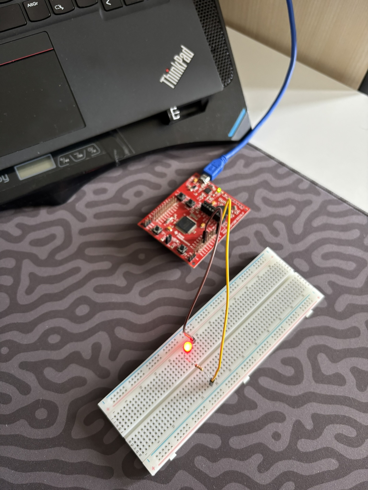
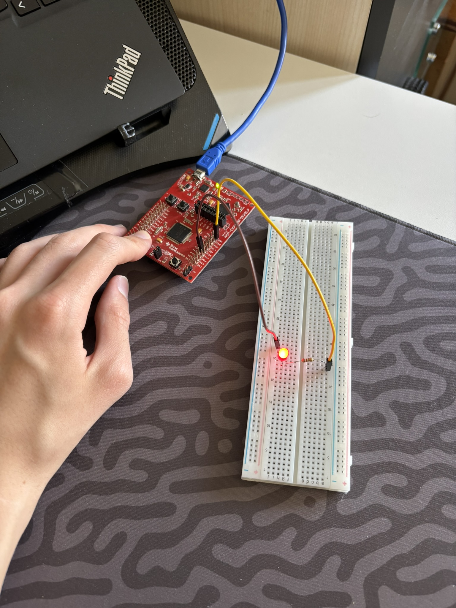
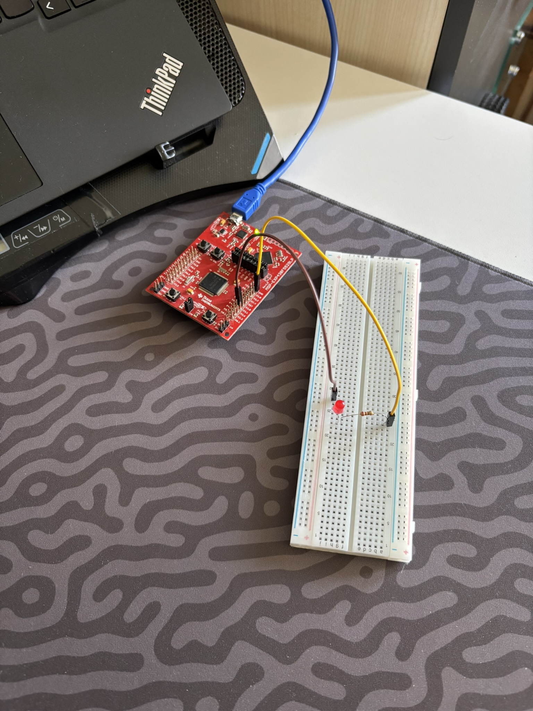

# 01 - TI MSP430F5529 LaunchPad: LED Blink ve Buton Kontrolü

Bu proje, **TI MSP-EXP430F5529LP (16-Bit Ultra-Low-Power RISC MSP430F5529)** geliştirme kartı için `timsp430` derleyicisini ve **TI DSLite (`eZ-FET`)** yükleme hattını doğrulamak, harici GPIO (`P1.2`) üzerinden LED sürmek ve kart üzerindeki yerleşik kullanıcı butonunu (`P2.1` / `PUSH1`) dahili pull-up direnciyle okumak amacıyla geliştirilmiştir.

---

## 🎯 Projenin Amacı ve Öğrenilen Kavramlar

1. **16-Bit RISC MSP430 Mimarisi ve Bellek Verimliliği:** 25 MHz saat hızında çalışan 16-bit MSP430F5529 işlemcisinde temel GPIO giriş/çıkış uygulamasının yalnızca **1,156 Byte Flash (`%2.4`)** ve **18 Byte RAM (`%0.2`)** tükettiğini gözlemleme.
2. **TI Port.Bit İsimlendirme Standardı (`Px_y`):** TI MSP430 mimarisinde pinlerin 8-bitlik portlar (`Port 1`, `Port 2`, ..., `Port 8`) halinde gruplandığını ve kart üzerindeki `P1.2`, `P2.1` ifadelerinin kod tarafında `P1_2` ve `P2_1` makrolarıyla temsil edildiğini öğrenme.
3. **eZ-FET Hata Ayıklayıcı ve USB CDC Sürücüsü:** Kartın üst kısmında yer alan yerleşik **eZ-FET** emülatörünün bilgisayarda iki ayrı arayüz (`MSP Debug Interface` ve `MSP Application UART1`) oluşturduğunu ve `dslite` aracının JTAG/Spy-Bi-Wire üzerinden Flash programlama yaptığını kavrama.

---

## 🛠️ Kullanılan Malzemeler

| Malzeme | Adet / Değer | Açıklama |
| :--- | :---: | :--- |
| **TI MSP-EXP430F5529LP** | 1 | 16-Bit RISC `MSP430F5529` (25 MHz, 128 KB Flash, 8 KB RAM) |
| **Breadboard** | 1 | Devre kurulum tablası |
| **Kırmızı LED** | 1 | Harici durum göstergesi (`P1.2`) |
| **Direnç** | 1 × `220Ω` / `330Ω` | LED akım sınırlama direnci |
| **Jumper Kablo** | 2 × Dişi-Erkek | `P1.2` ve `GND` pinlerini breadboard'a taşımak için |

---

## 🔌 Pin Bağlantı Tablosu ve Devre Şeması

| MSP430F5529 Pini | Konum | Bağlantı Noktası | Açıklama |
| :--- | :--- | :--- | :--- |
| **`P1.2` (`P1_2` / Pin 35)** | Sol header sırası | `10a` $\rightarrow$ Direnç $\rightarrow$ LED Uzun Bacak (`+`) | Harici LED sinyal çıkışı (`3.3V` / `0V`) |
| **`GND` (Pin 20 / 22)** | Sağ alt köşe header | `20a` $\rightarrow$ LED Kısa Bacak (`-`) | Ortak toprak (Eksi) hattı |
| **`P2.1` (`P2_1` / `PUSH1`)** | Sol alt köşe buton | Dahili Pull-Up Giriş (`INPUT_PULLUP`) | Basılmadığında `HIGH (1)`, basıldığında `LOW (0)` |

### ASCII Devre Şeması:
```text
      +3.3V / 0V
    (P1.2 / Pin 35)
          │
          ├───[ 330Ω Direnç ]───( + Anot )
          │                         │
          │                       [LED]
          │                         │
          │                     ( - Katot )
          │                         │
         GND ───────────────────────┘
```

---

## 💻 Geliştirme Aşamaları ve Kodlar

### Aşama 1: Periyodik LED Blink (`P1.2`)
`P1.2` pinine bağlı harici LED'in `500 ms` aralıklarla yanıp sönmesini sağlayan temel kod:

```cpp
#include <Arduino.h>

#define MY_LED_PIN P1_2

void setup() {
    pinMode(MY_LED_PIN, OUTPUT);
}

void loop() {
    digitalWrite(MY_LED_PIN, HIGH);
    delay(500);
    digitalWrite(MY_LED_PIN, LOW);
    delay(500);
}
```

### Aşama 2: `P2.1` (`PUSH1`) Butonu ile LED Kontrolü ([`src/main.cpp`](src/main.cpp))
Kartın sol alt köşesindeki `P2.1` butonuna basıldıkça LED'i yakan, bırakıldığında söndüren güncel kod:

```cpp
#include <Arduino.h>

#define MY_LED_PIN P1_2
#define BTN_SOL    P2_1

void setup() {
    pinMode(MY_LED_PIN, OUTPUT);
    pinMode(BTN_SOL, INPUT_PULLUP);
}

void loop() {
    if (digitalRead(BTN_SOL) == LOW) {
        digitalWrite(MY_LED_PIN, HIGH);
    } else {
        digitalWrite(MY_LED_PIN, LOW);
    }
}
```

---

## 🚀 Derleme ve Karta Yükleme Komutları (`pio`)

Ana proje dizinindeyken (`embedded-systems-lab/`):

```powershell
# Sadece derlemek (Build) için:
& "$HOME\.platformio\penv\Scripts\pio.exe" run -d "05_TI_MSP430F5529_LP/01_beginner/01_ucs_25mhz_dual_port_blink"

# Derleyip doğrudan eZ-FET üzerinden MSP430F5529 kartına yüklemek için:
& "$HOME\.platformio\penv\Scripts\pio.exe" run -d "05_TI_MSP430F5529_LP/01_beginner/01_ucs_25mhz_dual_port_blink" -t upload
```

---

## 📸 Kurulum ve Test Görselleri

| Periyodik LED Blink (`P1.2`) | `P2.1` Buton Basılı (LED Açık) | `P2.1` Buton Serbest (LED Kapalı) |
| :---: | :---: | :---: |
|  |  |  |


