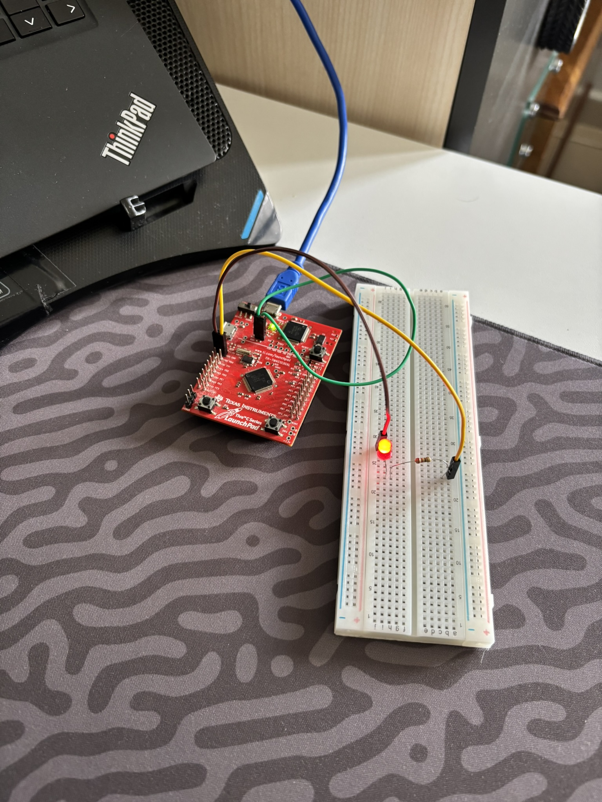
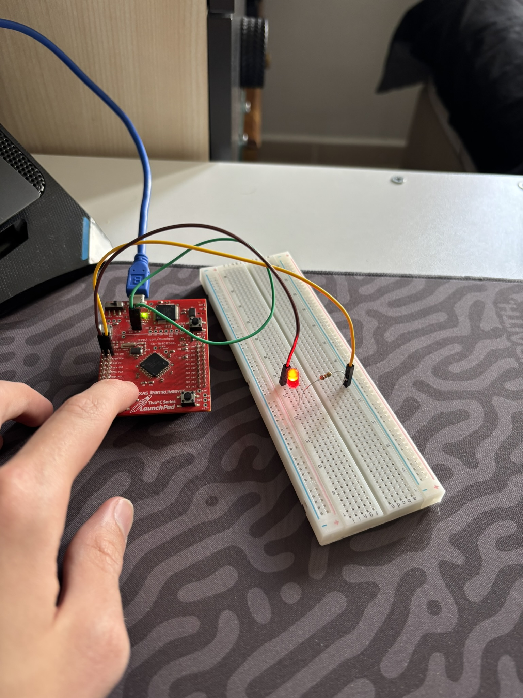
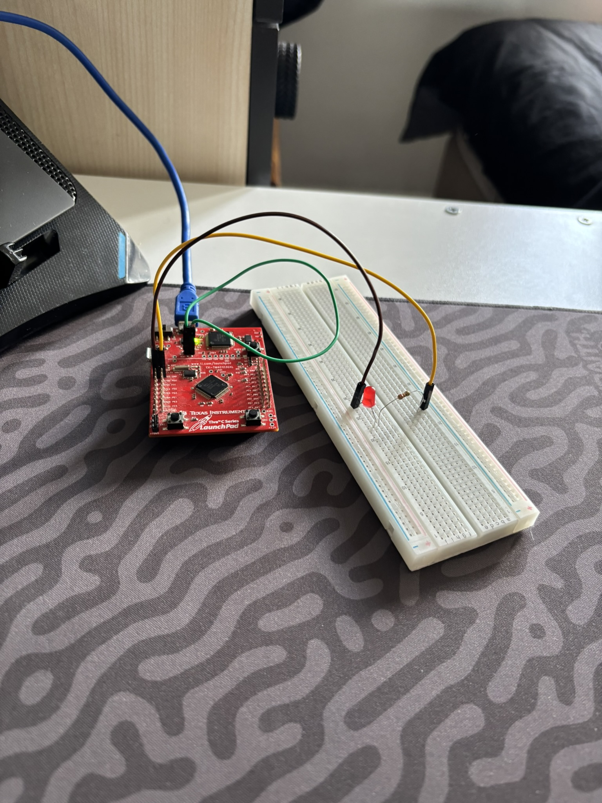

# 01 - TI EK-TM4C123GXL (Tiva C LaunchPad): LED Blink ve Buton Kontrolü

Bu proje, **TI EK-TM4C123GXL (32-Bit ARM Cortex-M4F @ 80 MHz)** geliştirme kartı için `titiva` derleyicisini ve **Stellaris ICDI (`OpenOCD` / `DSLite`)** yükleme hattını doğrulamak, harici GPIO (`PB5`) üzerinden LED sürmek ve kart üzerindeki yerleşik kullanıcı butonunu (`PF4` / `SW1`) dahili pull-up direnciyle (*Active-Low*) okumak amacıyla geliştirilmiştir.

---

## 🎯 Projenin Amacı ve Öğrenilen Kavramlar

1. **ARM Cortex-M4F Mimarisi ve Güç Hattı (`PWR SELECT` & `VDD` Jumper):** Tiva C LaunchPad üzerinde üstteki `DEBUG` USB soketinin hata ayıklayıcı çipe (`ICDI`) güç verirken, alt kısımdaki ana işlemciye (`TM4C123GH6PM`) gücün ulaşması için `PWR SELECT` anahtarının `DEBUG` yönünde olması ve `VDD` (`H1`) akım ölçüm köprüsünün (jumper) takılı olması gerektiğini deneyimleme.
2. **Active-Low ve Active-High Buton Mantığı:** Elektronikte `LOW (0V)` ve `HIGH (+3.3V)` seviyelerinin tek başına "basıldı/bırakıldı" anlamına gelmediğini; kart üzerindeki `SW1 (PF4)` butonunun diğer ucu fabrikada `GND` hattına lehimlendiği için **`INPUT_PULLUP` (Active-Low)** modunda kullanılması gerektiğini (`INPUT_PULLDOWN` yapıldığında her iki durumda da `0V` okunduğunu) test ederek doğrulama.
3. **Stellaris ICDI JTAG/SWD Yükleme Hattı:** Windows üzerinde `Stellaris ICDI JTAG/SWD Interface` sürücüsünü yapılandırarak `2,324 Byte Flash (%0.9)` ve `520 Byte RAM (%1.6)` kullanan ARM ikili dosyasını doğrudan donanıma yükleme.

---

## 🛠️ Kullanılan Malzemeler

| Malzeme | Adet / Değer | Açıklama |
| :--- | :---: | :--- |
| **TI EK-TM4C123GXL** | 1 | 32-Bit ARM Cortex-M4F `TM4C123GH6PM` (80 MHz, 256 KB Flash, 32 KB RAM) |
| **Breadboard** | 1 | Devre kurulum tablası |
| **Kırmızı LED** | 1 | Harici durum göstergesi (`PB5`) |
| **Direnç** | 1 × `220Ω` / `330Ω` | LED akım sınırlama direnci |
| **Jumper Kablo** | 2 × Dişi-Erkek | `PB5` ve `GND` pinlerini breadboard'a taşımak için |

---

## 🔌 Pin Bağlantı Tablosu ve Devre Şeması

| Tiva C Pini | Konum | Bağlantı Noktası | Açıklama |
| :--- | :--- | :--- | :--- |
| **`PB5` (`PB_5` / J1-2)** | Sol dış sıra, yukarıdan 2. pin | `10a` $\rightarrow$ Direnç $\rightarrow$ LED Uzun Bacak (`+`) | Harici LED sinyal çıkışı (`3.3V` / `0V`) |
| **`GND` (J3-2)** | Sağ dış sıra, yukarıdan 2. pin | `20a` $\rightarrow$ LED Kısa Bacak (`-`) | Ortak toprak (Eksi) hattı |
| **`PF4` (`PF_4` / `SW1`)** | Sol alt köşe buton | Dahili Pull-Up Giriş (`INPUT_PULLUP`) | Basılmadığında `HIGH (3.3V)`, basıldığında `LOW (0V)` |

### ASCII Devre Şeması:
```text
      +3.3V / 0V
     (PB5 / J1-2)
          │
          ├───[ 330Ω Direnç ]───( + Anot )
          │                         │
          │                       [LED]
          │                         │
          │                     ( - Katot )
          │                         │
         GND ───────────────────────┘
```

---

## 💻 Geliştirme Aşamaları ve Kodlar

### Aşama 1: Periyodik LED Blink (`PB5`)
`PB5` pinine bağlı harici LED'in `500 ms` aralıklarla yanıp sönmesini sağlayan temel kod:

```cpp
#include <Arduino.h>

#define MY_LED_PIN PB_5

void setup() {
    pinMode(MY_LED_PIN, OUTPUT);
}

void loop() {
    digitalWrite(MY_LED_PIN, HIGH);
    delay(500);
    digitalWrite(MY_LED_PIN, LOW);
    delay(500);
}
```

### Aşama 2: `PF4` (`SW1`) Butonu ile LED Kontrolü ([`src/main.cpp`](src/main.cpp))
Kartın sol alt köşesindeki `PF4` (`SW1`) butonuna basıldıkça (`LOW`) LED'i yakan (`HIGH`), bırakıldığında söndüren güncel kod:

```cpp
#include <Arduino.h>

#define MY_LED_PIN PB_5
#define MY_BTN_PIN PF_4

void setup(){
    pinMode(MY_LED_PIN, OUTPUT);
    pinMode(MY_BTN_PIN, INPUT_PULLUP);
}

void loop(){
    if (digitalRead(MY_BTN_PIN) == LOW){
        digitalWrite(MY_LED_PIN, HIGH);
    }else{
        digitalWrite(MY_LED_PIN, LOW);
    }
}
```

---

## 🚀 Derleme ve Karta Yükleme Komutları (`pio`)

Ana proje dizinindeyken (`embedded-systems-lab/`):

```powershell
# Sadece derlemek (Build) için:
& "$HOME\.platformio\penv\Scripts\pio.exe" run -d "06_TI_TM4C123GXL_TivaC/01_beginner/01_rgb_blink_bitbanding_pf0_unlock"

# Derleyip doğrudan Stellaris ICDI üzerinden Tiva C kartına yüklemek için:
& "$HOME\.platformio\penv\Scripts\pio.exe" run -d "06_TI_TM4C123GXL_TivaC/01_beginner/01_rgb_blink_bitbanding_pf0_unlock" -t upload
```

---

## 📸 Kurulum ve Test Görselleri

| Periyodik LED Blink (`PB5`) | `PF4` (`SW1`) Buton Basılı (LED Açık) | `PF4` (`SW1`) Buton Serbest (LED Kapalı) |
| :---: | :---: | :---: |
|  |  |  |

