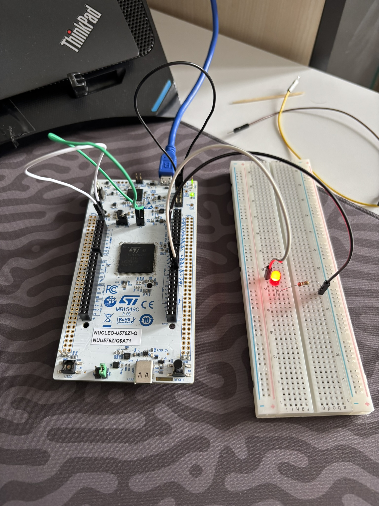
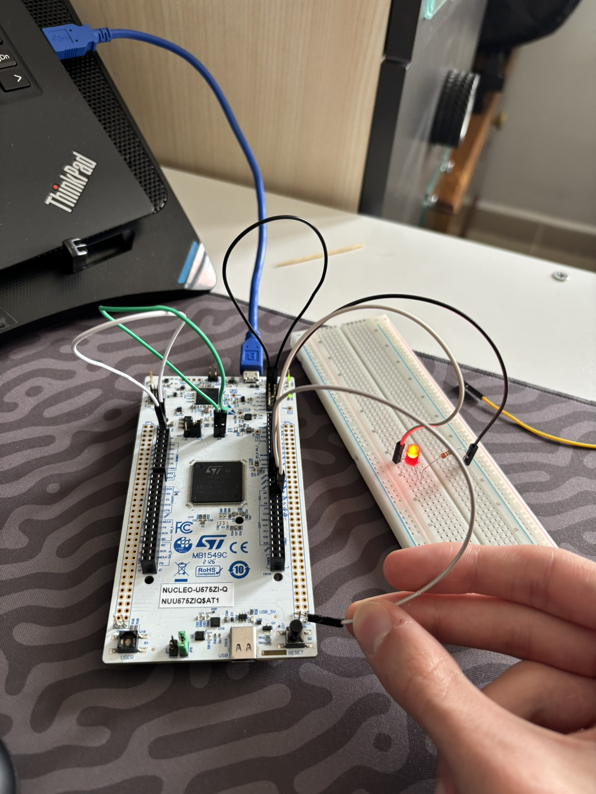
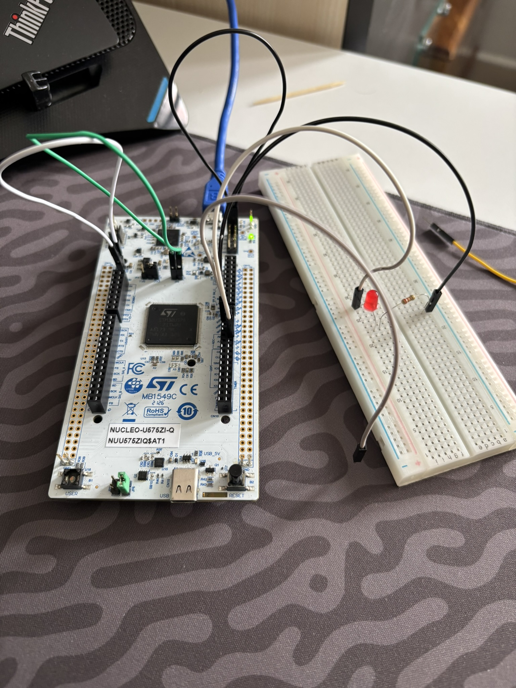

# 01 - ST NUCLEO-U575ZI-Q: LED Blink ve Jumper Kablo ile Buton Simülasyonu

Bu proje, **ST NUCLEO-U575ZI-Q (32-Bit ARM Cortex-M33 @ 160 MHz, TrustZone & Dahili SMPS)** geliştirme kartı için resmi `STMicroelectronics:stm32` çekirdeğini ve **ST-LINK/V3E (`OpenOCD`)** yükleme hattını doğrudan `arduino-cli` üzerinden doğrulamak, harici GPIO (`D2` / `PF15`) üzerinden LED sürmek ve kart üzerindeki yerleşik kullanıcı butonunun bulunmaması sebebiyle harici bir jumper kablosu (`D3` / `PE13`) ile mekanik buton simülasyonu gerçekleştirmek amacıyla geliştirilmiştir.

---

## 🎯 Projenin Amacı ve Öğrenilen Kavramlar

1. **ARM Cortex-M33 ve ST Nucleo-144 Güç Jumper Mimarisi:** NUCLEO-U575ZI-Q kartında işlemcinin çalışabilmesi için 4 temel jumper köprüsünün doğrulanması gerektiğini deneyimleme:
   - `JP6 [1-2]`: USB'den gelen 5V gerilimini karta bağlayan ana güç hattı (`5V_STLK`).
   - `JP4 [1-2]`: Hedef işlemci voltajını 3.3V olarak belirleyen seçici köprü.
   - `JP5 (IDD)`: 3.3V hattını doğrudan mikrodenetleyiciye aktaran akım ölçüm köprüsü.
   - `JP2 (T_NRST)`: ST-LINK ile mikrodenetleyici arasındaki donanımsal reset hattı köprüsü.
2. **Kablo ile Buton Simülasyonu (Active-Low Mantığı):** Kart üzerindeki yerleşik kullanıcı butonu (`B1 USER`) fiziksel olarak mevcut olmadığında, bir mikrodenetleyici pininin (`D3` / `PE13`) dahili dirençle yukarı çekilip (`INPUT_PULLUP`), bir jumper kablosunun ucu `GND` hattına dokundurulduğunda elektriksel olarak mekanik bir butona basılmasıyla birebir aynı etkiyi (`LOW` / 0V) yarattığını kavrama.
3. **`arduino-cli` ile Tertemiz Proje Yapısı:** PlatformIO gibi ek konfigürasyon (`platformio.ini`) ve derleme klasörleri (`.pio/`) oluşturmadan, doğrudan `arduino-cli` derleyicisiyle Windows `%TEMP%` dizininde derleme yaparak proje dizinini saf ve sade tutma.

---

## 🛠️ Kullanılan Malzemeler

| Malzeme | Adet / Değer | Açıklama |
| :--- | :---: | :--- |
| **ST NUCLEO-U575ZI-Q** | 1 | 32-Bit ARM Cortex-M33 `STM32U575ZIT6Q` (160 MHz, 2 MB Flash, 786 KB RAM) |
| **Breadboard** | 1 | Devre kurulum tablası |
| **Kırmızı LED** | 1 | Harici durum göstergesi (`D2` / `PF15`) |
| **Direnç** | 1 × `220Ω` / `330Ω` | LED akım sınırlama direnci |
| **Jumper Kablo** | 3 × Erkek-Erkek | `D2` (LED), `D3` (Buton simülasyonu) ve `GND` bağlantıları için |

---

## 🔌 Pin Bağlantı Tablosu ve Devre Şeması

| NUCLEO-U575ZI-Q Pini | Konum | Bağlantı Noktası | Açıklama |
| :--- | :--- | :--- | :--- |
| **`D2` (`PF15`)** | Sağ iç soket (`CN10`), alttan 3. delik | `10a` $\rightarrow$ Direnç $\rightarrow$ LED Uzun Bacak (`+`) | Harici LED sinyal çıkışı (`3.3V` / `0V`) |
| **`GND`** | Siyah dişi soket sırası | `20a` $\rightarrow$ LED Kısa Bacak (`-`) | Ortak toprak (Eksi) hattı |
| **`D3` (`PE13`)** | Sağ iç soket (`CN10`), `D2`'nin hemen üstü | Boştaki Jumper Kablosu | `INPUT_PULLUP` buton simülasyon pini |

### ASCII Devre Şeması:
```text
      +3.3V / 0V
     (D2 / PF15)
          │
          ├───[ 330Ω Direnç ]───( + Anot )
          │                         │
          │                       [LED]
          │                         │
          │                     ( - Katot )
          │                         │
         GND ───────────────────────┘
```

### Jumper Kablo ile Buton Nasıl Çalışır?

```text
          +3.3V (Dahili Pull-Up)
               │
        [Dahili Direnç] (INPUT_PULLUP)
               │
               ├────────► Mikrodenetleyici Pini (D3 / PE13)
               │
            [Kablo] ────► Boşta dururken: HIGH (3.3V) -> Buton Serbest
               │
               └────────► GND'ye dokunduğunda: LOW (0V) -> Butona Basıldı!
```

---

## 💻 Geliştirme Aşamaları ve Kodlar

### Aşama 1: Periyodik LED Blink (`D2` / `PF15`)
`D2` pinine bağlı harici LED'in `500 ms` aralıklarla yanıp sönmesini sağlayan temel kod:

```cpp
#include <Arduino.h>

#define MY_LED_PIN PF15   // D2

void setup() {
    pinMode(MY_LED_PIN, OUTPUT);
}

void loop() {
    digitalWrite(MY_LED_PIN, HIGH);
    delay(500);
    digitalWrite(MY_LED_PIN, LOW);
    delay(500);
}
```

### Aşama 2: `D3` Jumper Kablosu ile LED Kontrolü ([`src/main.cpp`](src/main.cpp))
`D3` pinine takılan jumper kablosunun ucu `GND` pinine dokundurulduğunda (`LOW`) LED'i yakan, kablo çekildiğinde (`HIGH`) söndüren güncel kod:

```cpp
#include <Arduino.h>

#define MY_LED_PIN PF15   // D2
#define MY_BTN_PIN PE13   // D3

void setup() {
    pinMode(MY_LED_PIN, OUTPUT);
    pinMode(MY_BTN_PIN, INPUT_PULLUP);
}

void loop() {
    if (digitalRead(MY_BTN_PIN) == LOW) { // Kablo GND'ye dokunduğunda
        digitalWrite(MY_LED_PIN, HIGH);
    } else {
        digitalWrite(MY_LED_PIN, LOW);
    }
}
```

---

## 🚀 Derleme ve Karta Yükleme Komutları (`arduino-cli`)

Ana proje dizinindeyken (`embedded-systems-lab/`):

```powershell
# Sadece derlemek (Build) için:
arduino-cli compile -b STMicroelectronics:stm32:Nucleo_144:pnum=NUCLEO_U575ZI_Q "07_ST_NUCLEO_U575ZI_Q/01_beginner/01_smps_power_and_bsrr_blink/src"

# Derleyip doğrudan OpenOCD ST-LINK üzerinden karta yüklemek için:
arduino-cli upload -b "STMicroelectronics:stm32:Nucleo_144:pnum=NUCLEO_U575ZI_Q,upload_method=OpenOCDSTLink" -p COM12 "07_ST_NUCLEO_U575ZI_Q/01_beginner/01_smps_power_and_bsrr_blink/src"
```

---

## 📸 Kurulum ve Test Görselleri

| Periyodik LED Blink (`D2`) | `D3` Kablo GND'de (LED Açık) | `D3` Kablo Boşta (LED Kapalı) |
| :---: | :---: | :---: |
|  |  |  |
