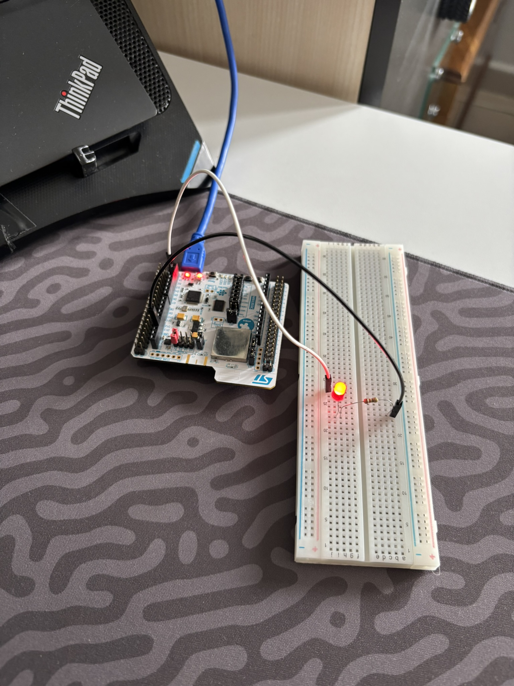
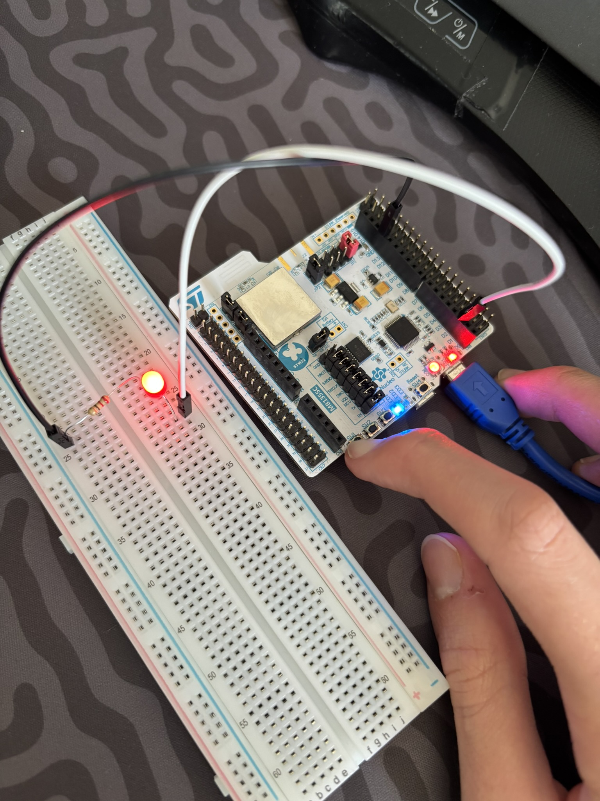
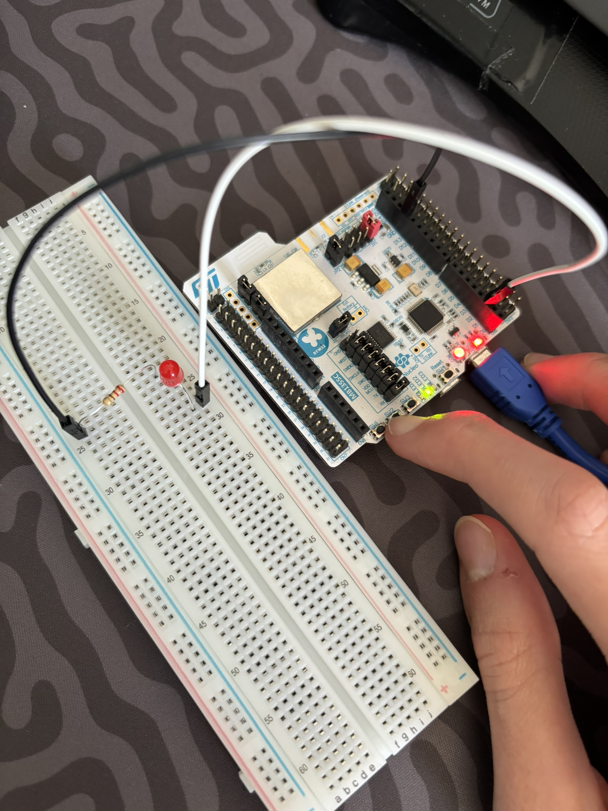
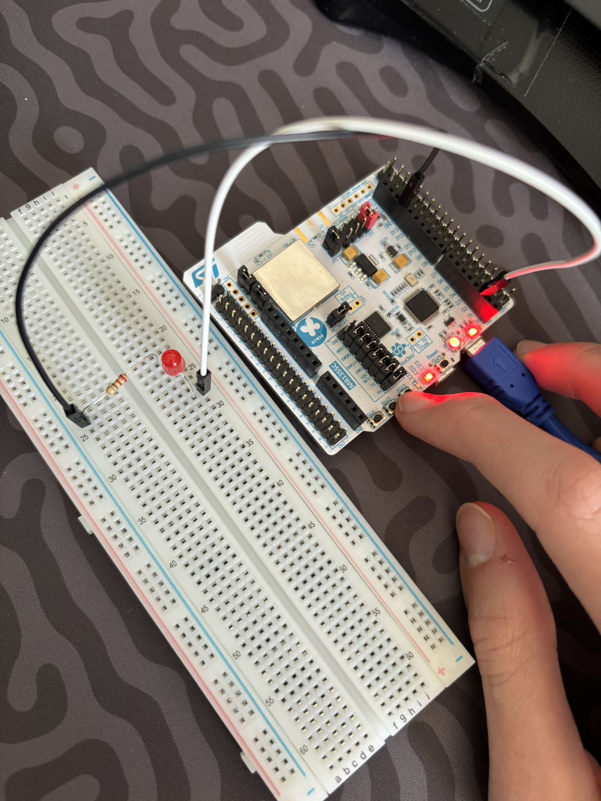

# 01 - ST P-NUCLEO-WB55: 3-Renk Yerleşik LED ve 3-Buton Çoklu Kontrol

Bu proje, **ST P-NUCLEO-WB55 (Çift Çekirdekli ARM Cortex-M4 @ 64 MHz + Cortex-M0+ BLE 5.0 / 802.15.4)** geliştirme kartı için resmi `STMicroelectronics:stm32` çekirdeğini ve **ST-LINK/V2-1 (`OpenOCD`)** yükleme hattını doğrudan `arduino-cli` üzerinden doğrulamak, harici GPIO (`D2` / `PC6`) üzerinden breadboard LED'ini sürmek ve kart üzerindeki 3 adet bağımsız kullanıcı butonunu (`SW1`, `SW2`, `SW3`) dahili pull-up dirençleriyle (*Active-Low*) okuyarak kartın 3 renkli durum LED'ini (**Mavi, Yeşil, Kırmızı**) ve harici LED'i eşzamanlı kontrol etmek amacıyla geliştirilmiştir.

---

## 🎯 Projenin Amacı ve Öğrenilen Kavramlar

1. **Çift Çekirdekli Kablosuz STM32WB55 Mimarisi ve Güç Hattı:** P-NUCLEO-WB55 kartında ana işlemciye USB üzerinden enerji ulaşabilmesi için `JP1` güç seçim jumper'ının mutlaka `[7-8]` nolu pinlerde (**`5V_USB_STLK`**) konumlandırılması gerektiğini deneyimleme.
2. **Çoklu Giriş/Çıkış Eşleme (3 Buton & 4 LED):** Kart üzerindeki 3 adet bağımsız butonun (`SW1`, `SW2`, `SW3`) diğer bacaklarının fabrikada `GND` hattına lehimlendiğini (*Active-Low*), bu sebeple `INPUT_PULLUP` modunda kurulduğunu ve her bir butonun bağımsız `if` bloklarıyla farklı bir rengi (Mavi `LED1`, Yeşil `LED2`, Kırmızı `LED3` ve Harici `D2`) tetiklediğini kavrama.
3. **`arduino-cli` ile Sıfır Konfigürasyon Dosyalı Derleme:** Herhangi bir `platformio.ini` veya `.pio/` klasörü olmadan, derleme ara dosyalarını Windows `%TEMP%` klasöründe tutarak reponun en saf standartta kalmasını sağlama.

---

## 🛠️ Kullanılan Malzemeler

| Malzeme | Adet / Değer | Açıklama |
| :--- | :---: | :--- |
| **ST P-NUCLEO-WB55** | 1 | Çift Çekirdek Cortex-M4/M0+ `STM32WB55RGV6` (64 MHz, 512 KB Flash, 192 KB RAM) |
| **Breadboard** | 1 | Devre kurulum tablası |
| **Kırmızı LED** | 1 | Harici durum göstergesi (`D2` / `PC6`) |
| **Direnç** | 1 × `220Ω` / `330Ω` | LED akım sınırlama direnci |
| **Jumper Kablo** | 2 × Erkek-Erkek | `D2` ve `GND` pinlerini breadboard'a taşımak için |

---

## 🔌 Pin ve Buton/LED Eşleşme Tablosu

| Donanım Adı | Pin Adı | Mod | Renk / Fonksiyon | Açıklama |
| :--- | :--- | :---: | :---: | :--- |
| **`EXT_LED`** | `D2` (`PC6`) | `OUTPUT` | Kırmızı (Harici) | Breadboard üzerindeki harici LED (`10a`) |
| **`LED1`** | `PB5` | `OUTPUT` | Mavi (Dahili) | Kart üzerindeki 1. durum LED'i |
| **`LED2`** | `PB0` | `OUTPUT` | Yeşil (Dahili) | Kart üzerindeki 2. durum LED'i |
| **`LED3`** | `PB1` | `OUTPUT` | Kırmızı (Dahili) | Kart üzerindeki 3. durum LED'i |
| **`SW1_BTN`** | `PC4` | `INPUT_PULLUP` | Buton 1 | Basılınca `LOW` $\rightarrow$ `LED1` (Mavi) ve `EXT_LED` yanar |
| **`SW2_BTN`** | `PD0` | `INPUT_PULLUP` | Buton 2 | Basılınca `LOW` $\rightarrow$ `LED2` (Yeşil) yanar |
| **`SW3_BTN`** | `PD1` | `INPUT_PULLUP` | Buton 3 | Basılınca `LOW` $\rightarrow$ `LED3` (Kırmızı) yanar |

### ASCII Devre Şeması (Harici LED):
```text
      +3.3V / 0V
     (D2 / PC6)
          │
          ├───[ 330Ω Direnç ]───( + Anot )
          │                         │
          │                       [LED]
          │                         │
          │                     ( - Katot )
          │                         │
         GND ───────────────────────┘
```

---

## 💻 Geliştirme Aşamaları ve Kodlar

### Aşama 1: Temel Harici LED Blink
`D2` (`PC6`) pinine bağlı harici LED'in `500 ms` aralıklarla yanıp sönmesini sağlayan temel kod:

```cpp
#include <Arduino.h>

#define MY_LED_PIN PC6   // D2

void setup() {
    pinMode(MY_LED_PIN, OUTPUT);
}

void loop() {
    digitalWrite(MY_LED_PIN, HIGH);
    delay(500);
    digitalWrite(MY_LED_PIN, LOW);
    delay(500);
}
```

### Aşama 2: 3-Buton ile 3-LED + Harici LED Kontrolü ([`src/main.cpp`](src/main.cpp))
Kartın üzerindeki 3 butonu dinleyerek basılan butona göre ilgili LED'i yakan, bırakıldığında söndüren güncel kod:

```cpp
#include <Arduino.h>

#define EXT_LED D2

void setup() {
    // Çıkışlar (LED'ler)
    pinMode(EXT_LED, OUTPUT);
    pinMode(LED1, OUTPUT);    // Mavi LED
    pinMode(LED2, OUTPUT);    // Yeşil LED
    pinMode(LED3, OUTPUT);    // Kırmızı LED

    // Girişler (Active-Low Butonlar)
    pinMode(SW1_BTN, INPUT_PULLUP);
    pinMode(SW2_BTN, INPUT_PULLUP);
    pinMode(SW3_BTN, INPUT_PULLUP);
}

void loop() {
    // 1. Buton (SW1) -> Mavi LED ve Harici Breadboard LED
    if (digitalRead(SW1_BTN) == LOW) {
        digitalWrite(LED1, HIGH);
        digitalWrite(EXT_LED, HIGH);
    } else {
        digitalWrite(LED1, LOW);
        digitalWrite(EXT_LED, LOW);
    }

    // 2. Buton (SW2) -> Yeşil LED
    if (digitalRead(SW2_BTN) == LOW) {
        digitalWrite(LED2, HIGH);
    } else {
        digitalWrite(LED2, LOW);
    }

    // 3. Buton (SW3) -> Kırmızı LED
    if (digitalRead(SW3_BTN) == LOW) {
        digitalWrite(LED3, HIGH);
    } else {
        digitalWrite(LED3, LOW);
    }
}
```

---

## 🚀 Derleme ve Karta Yükleme Komutları (`arduino-cli`)

Ana proje dizinindeyken (`embedded-systems-lab/`):

```powershell
# Sadece derlemek (Build) için:
arduino-cli compile -b STMicroelectronics:stm32:Nucleo_64:pnum=P_NUCLEO_WB55RG "08_ST_P_NUCLEO_WB55/01_beginner/01_dual_core_hsem_and_dongle_blink/src"

# Derleyip doğrudan OpenOCD ST-LINK üzerinden karta yüklemek için:
arduino-cli upload -b "STMicroelectronics:stm32:Nucleo_64:pnum=P_NUCLEO_WB55RG,upload_method=OpenOCDSTLink" -p COM13 "08_ST_P_NUCLEO_WB55/01_beginner/01_dual_core_hsem_and_dongle_blink/src"
```

---

## 📸 Kurulum ve Test Görselleri

| Periyodik Blink (`D2`) | `SW1` Basılı (Mavi + Harici LED) | `SW2` Basılı (Yeşil LED) | `SW3` Basılı (Kırmızı LED) |
| :---: | :---: | :---: | :---: |
|  |  |  |  |

