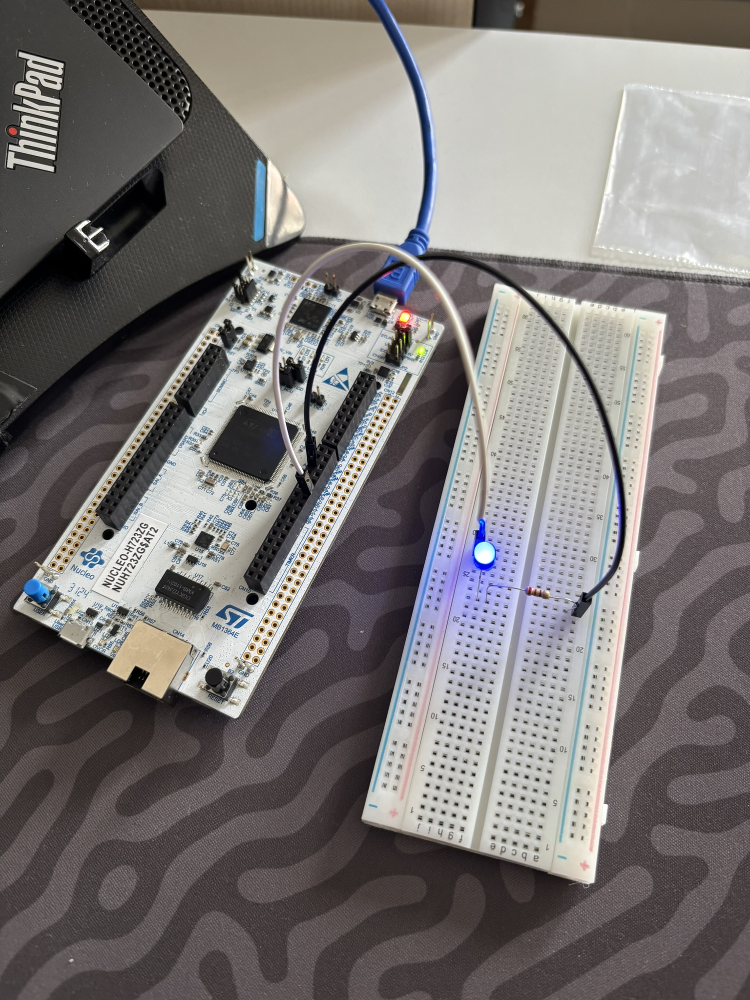
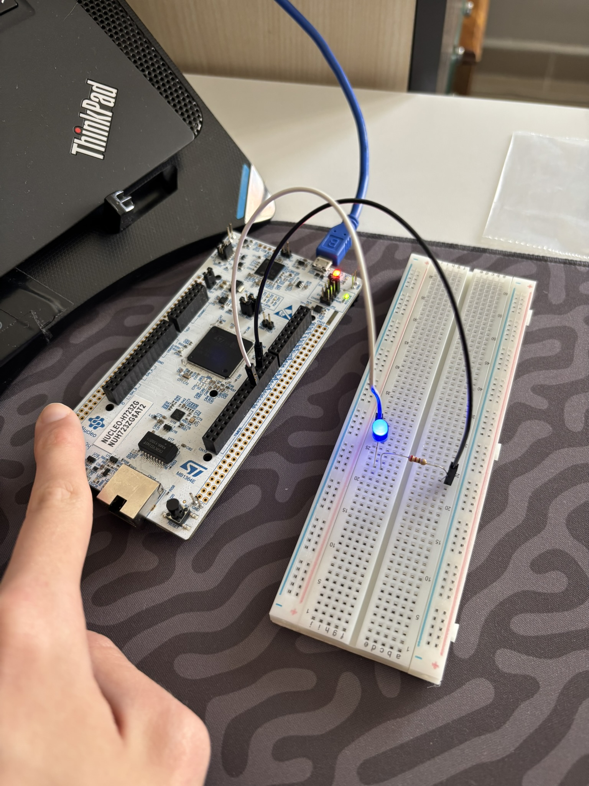
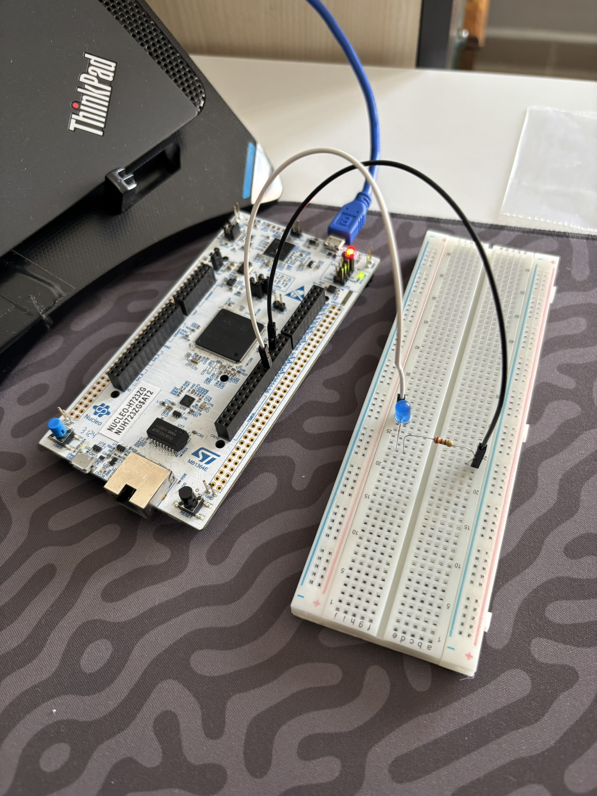

# 01 - ST NUCLEO-H723ZG: ARM Cortex-M7 (550 MHz) ile LED & Kullanıcı Butonu Kontrolü

Bu proje, portföyün en yüksek işlem gücüne sahip mikrodenetleyicisi olan **ST NUCLEO-H723ZG (ARM Cortex-M7 @ 550 MHz, 32 KB I-Cache / 32 KB D-Cache, 1 MB Flash, 564 KB SRAM)** geliştirme kartı üzerinde temel GPIO çıkışını (`D2` / `PG14`) ve yerleşik kullanıcı butonunu (`B1` / `USER_BTN` / `PC13`) doğrulamak amacıyla geliştirilmiştir.

Resmi `STMicroelectronics:stm32` çekirdeği ve yerleşik **ST-LINK/V3E (`OpenOCD`)** hata ayıklayıcı hattı doğrudan `arduino-cli` üzerinden kullanılmış; harici proje konfigürasyon dosyası (`platformio.ini`) olmadan saf ve temiz bir mimari korunmuştur.

---

## 🎯 Projenin Amacı ve Öğrenilen Kavramlar

1. **Ultra Yüksek Hızlı Cortex-M7 Mimarisi:** 550 MHz çekirdek frekansı, çift duyarlıklı FPU (DP-FPU), L1 Veri & Komut Önbellekleri (32KB D-Cache / 32KB I-Cache) ve AXI/TCM veriyolu mimarisiyle endüstriyel sınıf STM32H7 serisinin donanım ve derleme altyapısını tanıma.
2. **Nucleo-144 Form Faktörü ve Pin Haritalandırması:** Arduino Uno Rev3 pin uyumluluğuna sahip `CN7`, `CN8`, `CN9`, `CN10` genişleme konnektörleri üzerinden `D2` (`PG14`) çıkış pini ve `GND` referans hattını breadboard devresine bağlama.
3. **Donanımsal Buton Polaritesi (*Active-High* Mantığı):** Nucleo-144 standartlarında yerleşik mavi kullanıcı butonu (`B1` / `PC13`), fabrikasyon olarak harici pull-down direnciyle `GND` seviyesinde tutulur. Butona basıldığında hat doğrudan `+3.3V (VDD)` seviyesine çekilir. Bu nedenle yazılımda buton okuması `HIGH` seviyesinde tetiklenir:
   $$\text{Buton Durumu} = \begin{cases} \text{HIGH (1)}, & \text{Basılı} \\ \text{LOW (0)}, & \text{Bırakılmış} \end{cases}$$
4. **ST-LINK/V3E ve OpenOCD Entegrasyonu:** STM32H7 gibi gelişmiş çekirdeklerde OpenOCD SWD protokolü üzerinden doğrudan Flash programlama ve donanımsal sıfırlama sürecini uçtan uca çalıştırma.

---

## 🛠️ Kullanılan Malzemeler

| Malzeme | Adet / Değer | Açıklama |
| :--- | :---: | :--- |
| **ST NUCLEO-H723ZG** | 1 | ARM Cortex-M7 @ 550 MHz `STM32H723ZGT6` (1 MB Flash, 564 KB SRAM, ST-LINK/V3E) |
| **Breadboard** | 1 | Devre kurulum tablası |
| **Kırmızı LED** | 1 | Harici durum göstergesi (`D2` / `PG14`) |
| **Direnç** | 1 × `330Ω` | LED akım sınırlama direnci (Breadboard `10b` - `10e`) |
| **Jumper Kablo** | 2 × Erkek-Erkek | `D2` $\rightarrow$ `10a` ve `GND` $\rightarrow$ `20a` bağlantıları için |

---

## 🔌 Pin ve Donanım Bağlantı Tablosu

| Donanım Adı | Kart Pini | MCU Port/Pini | Mod | Polarite / Mantık | Açıklama |
| :--- | :--- | :--- | :---: | :---: | :--- |
| **`MY_LED_PIN`** | `D2` | `PG14` | `OUTPUT` | Active-High | Breadboard üzerindeki kırmızı LED (`10a` Anot) |
| **`MY_BTN_PIN`** | `USER_BTN` / `B1` | `PC13` | `INPUT` | Active-High | Kart üzerindeki mavi kullanıcı butonu (Donanımsal Pull-Down) |
| **`GND`** | `GND` | `GND` | Güç | `0V` | Breadboard katot hattı (`20a`) |

### ASCII Devre Şeması:
```text
       ST NUCLEO-H723ZG
   ┌──────────────────────┐
   │                      │
   │  [ D2 / PG14 ]───────┼────[ 330Ω Direnç ]────( + Anot )
   │                      │                            │
   │                      │                          [LED] (Kırmızı)
   │                      │                            │
   │  [ GND ]─────────────┼───────────────────────( - Katot )
   │                      │
   │  [ B1 (Mavi Buton) ] │ (PC13 - Dahili Donanımsal Pull-Down)
   └──────────────────────┘
```

---

## 💻 Geliştirme Aşamaları ve Kodlar

### Aşama 1: Temel Harici LED Blink
`D2` (`PG14`) pinine bağlı harici LED'i 500 ms aralıklarla periyodik olarak yakıp söndüren temel kod:

```cpp
#include <Arduino.h>

#define MY_LED_PIN D2

void setup() {
    pinMode(MY_LED_PIN, OUTPUT);
}

void loop() {
    digitalWrite(MY_LED_PIN, HIGH);
    delay(500);
    digitalWrite(MY_LED_PIN, LOW);
    delay(500);
}
```

### Aşama 2: Yerleşik Buton ile Harici LED Kontrolü ([`src/main.cpp`](src/main.cpp))
Kartın üzerindeki mavi kullanıcı butonuna (`B1` / `USER_BTN`) basıldığında harici LED'i yakan, bırakıldığında anında söndüren güncel kod:

```cpp
#include <Arduino.h>

#define MY_LED_PIN D2
#define MY_BTN_PIN USER_BTN   // Kartın üzerindeki mavi kullanıcı butonu (PC13)

void setup() {
    pinMode(MY_LED_PIN, OUTPUT);
    pinMode(MY_BTN_PIN, INPUT);
}

void loop() {
    if (digitalRead(MY_BTN_PIN) == HIGH) { // Mavi butona basıldığında (Active-High!)
        digitalWrite(MY_LED_PIN, HIGH);
    } else {
        digitalWrite(MY_LED_PIN, LOW);
    }
}
```

---

## 🚀 Derleme ve Karta Yükleme Komutları (`arduino-cli`)

Ana proje kök dizinindeyken (`embedded-systems-lab/`):

```powershell
# Sadece derlemek (Build) için:
arduino-cli compile -b STMicroelectronics:stm32:Nucleo_144:pnum=NUCLEO_H723ZG "09_ST_NUCLEO_H723ZG/01_beginner/01_m7_550mhz_dcache_clean_blink/src"

# Derleyip doğrudan OpenOCD ST-LINK üzerinden karta yüklemek için:
arduino-cli upload -b "STMicroelectronics:stm32:Nucleo_144:pnum=NUCLEO_H723ZG,upload_method=OpenOCDSTLink" -p COM11 "09_ST_NUCLEO_H723ZG/01_beginner/01_m7_550mhz_dcache_clean_blink/src"
```

---

## 📸 Kurulum ve Test Görselleri

| Aşama 1: Periyodik Blink | Aşama 2: Buton Basılı (`LED ON`) | Aşama 2: Buton Bırakıldı (`LED OFF`) |
| :---: | :---: | :---: |
|  |  |  |

