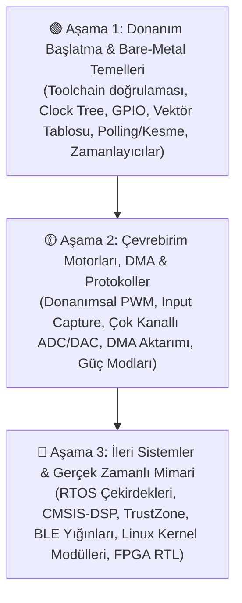
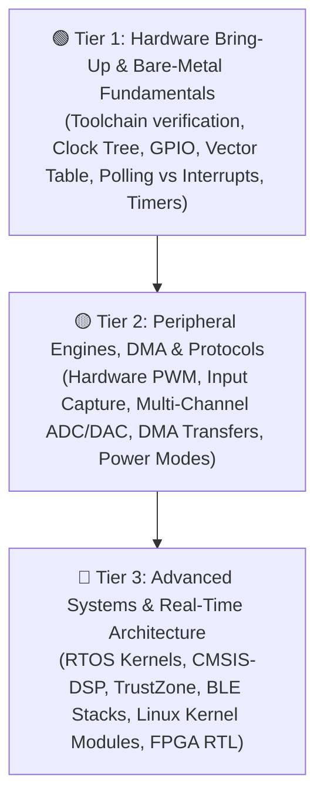

# ⚡Embedded Systems Engineering Lab

[](https://en.wikipedia.org/wiki/C_(programming_language))
[](https://code.visualstudio.com/)
[](#-hedef-kartlar--mimari-matrisi)
[](https://opensource.org/licenses/MIT)

> 🌐 **Language / Dil:** [🇹🇷 Türkçe](#-türkçe) | [🇬🇧 English](#-english)

---

# 🇹🇷 Türkçe

> Bu depo; **6 farklı işlemci mimarisi** ve **12 geliştirme kartı** üzerinde yürütülen, register seviyesinde bare-metal programlamadan Gerçek Zamanlı İşletim Sistemlerine (RTOS), DSP/sinyal işlemeye, gömülü Linux çekirdek sürücülerine ve FPGA sayısal tasarımına kadar uzanan **144 projeyi** kapsayan kapsamlı bir gömülü sistemler mühendisliği laboratuvarı ve portfolyosudur.

---

## 🧭 Genel Bakış ve Amaç

Gömülü sistemler mühendisliği, donanımın elektriksel karakteristikleri ile düşük seviyeli yazılım soyutlamalarının bir arada öğrenilmesini gerektirir. Bu monorepo, gömülü sistemler disiplinindeki teknik gelişimi katman katman belgeler:

*   **Katman 1 (Bare-Metal & Silikon Mimarisi):** Saat ağacı (Clock Tree) yapılandırması, kesme vektör tabloları, yazmaç (register) seviyesinde bit manipülasyonu, SysTick ve donanımsal kesme denetleyicileri (NVIC).
*   **Katman 2 (Çevrebirim Motorları & DMA):** Donanımsal zamanlayıcılar (Timers), PWM üretimi, Input Capture darbe ölçümü, çok kanallı ADC/DAC ve DMA kontrolcü mimarileri.
*   **Katman 3 (İleri Sistemler & Eşzamanlılık):** Preemptive RTOS (FreeRTOS/ThreadX) görev yönetimi, CMSIS-DSP gerçek zamanlı sinyal işleme, kablosuz ağ protokolleri (BLE 5.0, ESP-NOW), Gömülü Linux aygıt sürücüleri ve FPGA üzerinde sayısal mantık sentezi (Verilog).

---

## 🔬 Hedef Kartlar & Mimari Matrisi

| Geliştirme Kartı | Çekirdek / Mimari | Maks. Saat Hızı | Bellek (Flash / RAM) | Bu Depodaki Temel Odak Noktası |
| :--- | :--- | :--- | :--- | :--- |
| **ST NUCLEO-H723ZG** | ARM Cortex-M7 (w/ DP-FPU) | 550 MHz | 1 MB / 564 KB | CMSIS-DSP, Hızlı Fourier Dönüşümü (FFT), Önbellek Tutarlılığı, İleri DMA |
| **ST NUCLEO-U575ZI-Q** | ARM Cortex-M33 (TrustZone) | 160 MHz | 2 MB / 786 KB | Ultra Düşük Güç (STOP2), Otonom LPBAM DMA, Donanımsal Güvenlik |
| **ST P-NUCLEO-WB55** | Çift Çekirdek: Cortex-M4 + M0+ | 64 / 32 MHz | 1 MB / 256 KB | Çekirdekler Arası IPC (HSEM/IPCC), BLE 5.0 GATT, IEEE 802.15.4 MAC |
| **TI EK-TM4C123GXL** | ARM Cortex-M4F | 80 MHz | 256 KB / 32 KB | Bit-Banding, Motion Control PWM, Sıfırdan Preemptive RTOS Çekirdeği |
| **Raspberry Pi Pico 2 W** | Çift Cortex-M33 / Çift RISC-V | 150 MHz | 4 MB / 520 KB | Programlanabilir I/O (PIO), Mimari Kıyaslama, Çok Çekirdekli FIFO |
| **ESP-WROOM-32** | Çift Çekirdek Xtensa LX6 | 240 MHz | 4 MB / 520 KB | Çift Çekirdekli FreeRTOS Eşzamanlılığı, Non-blocking Soketler, BLE/Wi-Fi |
| **ESP32-C3 Super Mini** | Tek Çekirdek 32-bit RISC-V | 160 MHz | 4 MB / 400 KB | RISC-V CSR Profilleme, Active-Low GPIO Mantığı, Düşük Gecikmeli ESP-NOW |
| **TI MSP430F5529 LP** | 16-bit MSP430X RISC | 25 MHz | 128 KB / 10 KB | Donanımsal USB 2.0 (HID/CDC), Donanım Çarpanı (MPY32), Unified Clock |
| **TI MSP-EXP430G2** | 16-bit MSP430 RISC | 16 MHz | 16 KB / **512 B** | Kısıtlı Kaynak (512B RAM) Optimizasyonu, Register Bare-Metal, LPM4 Uyku |
| **CRIUS AIOP PRO** | 8-bit AVR (ATmega2560) | 16 MHz | 256 KB / 8 KB | 8-bit Register Programlama, Donanımsal Çoklu Zamanlayıcılar, Kademeli PID |
| **Raspberry Pi Zero W** | ARM1176JZF-S (Gömülü Linux) | 1.0 GHz | 512 MB | Linux Karakter Sürücüleri (LKM), sysfs, `libgpiod`, Çok İş Parçacıklı POSIX |
| **Tang Nano 9K** | Gowin GW1NR-9 FPGA | 27 MHz OSC | 8,640 LUT4 | Verilog RTL, Sonlu Durum Makineleri (FSM), Soft-Core RISC-V SoC |

---

## 📁 Dizin Yapısı

```text
embedded-systems-lab/
├── docs/                             # Mimari notları, donanım register kılavuzları, yol haritası
│
├── 01-esp32-wroom/                   # Xtensa Çift Çekirdek FreeRTOS & IoT Projeleri
├── 02-esp32-c3-riscv/                # RISC-V 32-bit Mimarisi & Kompakt Düğümler
├── 03-rpi-pico2w/                    # RP2350 PIO Durum Makineleri & Çift Çekirdek SDK
├── 04-stm32-h723-cortex-m7/          # 550 MHz CMSIS-DSP & Gerçek Zamanlı Sinyal İşleme
├── 05-stm32-u575-cortex-m33/         # Otonom LPBAM & TrustZone Güvenlik Katmanı
├── 06-stm32-wb55-dual-core/          # BLE 5.0 Özel GATT Servisleri & IEEE 802.15.4 MAC
├── 07-msp430g2-baremetal/            # 512 Byte RAM Optimizasyonu & Register Seviyesi
├── 08-msp430f5529-usb/               # Donanımsal Full-Speed USB (HID/CDC) & DMA
├── 09-tm4c123-tiva-c/                # Motion Control PWM & Özel Preemptive Scheduler
├── 10-crius-atmega2560/              # 8-bit AVR Bare-Metal & Kademeli PID Kontrolü
├── 11-rpi-zero-w-linux/              # Gömülü Linux, Karakter Sürücüleri & Kernel Modülleri
└── 12-tang-nano-9k-fpga/             # Verilog HDL Sayısal Tasarım & Soft RISC-V SoC
```

---

## 🚀 3 Seviyeli Mimari Yol Haritası (Toplam 144 Proje)

Her kart için **12 ayrı proje** kurgulanmış olup adım adım ileri seviyeye ilerlenir:



### Öne Çıkan Mimari Uygulamalar

1.  **512 Byte RAM Sınırlarında Çalışma (`07-msp430g2-baremetal`):** Dinamik bellek (heap) kullanımından kaçınarak, sabit nokta aritmetiği ve doğrudan yazmaç manipülasyonu ile LPM4 derin uykuda ultra verimli bare-metal geliştirme.
2.  **Otonom LPBAM Arka Plan Veri İşleme (`05-stm32-u575-cortex-m33`):** Cortex-M33 çekirdeği STOP2 uykusundayken CPU müdahalesi olmadan LPTIM ve LPDMA ile otonom örnekleme yürütme.
3.  **CMSIS-DSP ile Gerçek Zamanlı Sinyal İşleme (`04-stm32-h723-cortex-m7`):** Timer tetiklemeli ADC örnekleme, çift tamponlu DMA (Ping-Pong) ve çift hassasiyetli FPU ile 1024-nokta FFT hesabı.
4.  **PIO ile Donanımsal Durum Makineleri (`03-rpi-pico2w`):** Zaman açısından kritik protokolleri işlemci çekirdeklerine yük bindirmeden 150 MHz'de çalışan PIO durum makinelerine devretme.
5.  **Sıfırdan Preemptive Görev Değiştirici (`09-tm4c123-tiva-c`):** ARM Cortex-M PendSV istisnası ve assembly yığın manipülasyonu (`R4-R11`, `PSP`) ile sıfırdan görev zamanlayıcı çekirdeği kodlama.
6.  **FPGA İçine Soft-Core RISC-V İşlemci Gömme (`12-tang-nano-9k-fpga`):** 32-bit `PicoRV32` RISC-V çekirdeğini Verilog ile FPGA içinde sentezleyip, bellek eşlemeli donanım çevrebirimleriyle C kodu koşturma.

---

## 🛠️ Geliştirme Ortamı ve Derleyiciler

*   **Ana IDE:** Visual Studio Code
*   **Derleme Sistemleri:**
    *   [PlatformIO Core](https://platformio.org/) (ESP32, RP2350, AVR, MSP430 için)
    *   [STM32CubeIDE / STM32CubeCLT](https://www.st.com/) + `STM32_Programmer_CLI` (STM32 H7/U5/WB için)
    *   [Gowin EDA](https://www.gowinsemi.com/) + [openFPGALoader](https://github.com/trabucayre/openFPGALoader) (Tang Nano 9K için)
*   **Çapraz Derleyiciler (Cross-Compilers):** `arm-none-eabi-gcc`, `riscv32-esp-elf-gcc`, `msp430-elf-gcc`, `avr-gcc`

---
---

# 🇬🇧 English

> A rigorous, hands-on embedded systems laboratory and portfolio covering **12 development boards** across **6 distinct processor architectures**, spanning **144 progressive projects**—from register-level bare-metal bring-up to real-time operating systems (RTOS), DSP/signal analysis, embedded Linux kernel drivers, and FPGA hardware synthesis.

---

## 🧭 Overview & Motivation

Embedded systems engineering requires mastering low-level software abstractions across diverse silicon targets. This monorepo documents my structured progression through the embedded engineering spectrum:

*   **Layer 1 (Bare-Metal & Silicon Architecture):** Clock tree configuration, vector tables, register manipulation, SysTick, and hardware interrupt controllers (NVIC).
*   **Layer 2 (On-Chip Peripheral Engines & DMA):** Hardware Timers, PWM generation, Input Capture, multi-channel ADC/DAC, and DMA controller architectures.
*   **Layer 3 (Advanced Systems & Concurrency):** Preemptive RTOS (FreeRTOS/ThreadX), CMSIS-DSP real-time signal processing, wireless protocol stacks (BLE 5.0, ESP-NOW), Embedded Linux device drivers, and digital logic synthesis (Verilog on FPGA).

---

## 🔬 Target Platforms & Architecture Matrix

| Target Platform | Core / Architecture | Max Clock | Memory (Flash / RAM) | Primary Focus in this Repo |
| :--- | :--- | :--- | :--- | :--- |
| **ST NUCLEO-H723ZG** | ARM Cortex-M7 (w/ DP-FPU) | 550 MHz | 1 MB / 564 KB | CMSIS-DSP, Fast Fourier Transform (FFT), Cache Coherency, Advanced DMA |
| **ST NUCLEO-U575ZI-Q** | ARM Cortex-M33 (TrustZone) | 160 MHz | 2 MB / 786 KB | Ultra-Low-Power (STOP2), LPBAM Autonomous DMA, Memory Security |
| **ST P-NUCLEO-WB55** | Dual-Core: Cortex-M4 + M0+ | 64 / 32 MHz | 1 MB / 256 KB | Inter-Core IPC (HSEM/IPCC), BLE 5.0 Stack, IEEE 802.15.4 MAC |
| **TI EK-TM4C123GXL** | ARM Cortex-M4F | 80 MHz | 256 KB / 32 KB | Bit-Banding, Motion Control PWM, Custom Preemptive RTOS Kernel |
| **Raspberry Pi Pico 2 W** | Dual Cortex-M33 / Dual RISC-V | 150 MHz | 4 MB / 520 KB | Programmable I/O (PIO), Architecture Benchmarking, Multi-Core FIFO |
| **ESP-WROOM-32** | Dual-Core Xtensa LX6 | 240 MHz | 4 MB / 520 KB | Dual-Core FreeRTOS Concurrency, Non-blocking Sockets, BLE/Wi-Fi |
| **ESP32-C3 Super Mini** | Single-Core 32-bit RISC-V | 160 MHz | 4 MB / 400 KB | RISC-V CSR Profiling, Active-Low GPIO, ESP-NOW Low-Latency Telemetry |
| **TI MSP430F5529 LP** | 16-bit MSP430X RISC | 25 MHz | 128 KB / 10 KB | Full-Speed USB 2.0 (HID/CDC), Hardware Multiplier (MPY32), Unified Clock |
| **TI MSP-EXP430G2** | 16-bit MSP430 RISC | 16 MHz | 16 KB / **512 B** | Extreme Resource Constraint Optimization, Register-level LPM4 Sleep |
| **CRIUS AIOP PRO** | 8-bit AVR (ATmega2560) | 16 MHz | 256 KB / 8 KB | 8-bit Register Bare-Metal, Multi-Channel Hardware Timers, Cascaded PID |
| **Raspberry Pi Zero W** | ARM1176JZF-S (Embedded Linux) | 1.0 GHz | 512 MB | Linux Kernel Modules (LKM), sysfs, `libgpiod`, Multi-Threaded POSIX |
| **Tang Nano 9K** | Gowin GW1NR-9 FPGA | 27 MHz OSC | 8,640 LUT4 | Verilog RTL, Finite State Machines (FSM), Soft-Core RISC-V SoC |

---

## 📁 Repository Organization

```text
embedded-systems-lab/
├── docs/                             # Hardware schematics, architecture notes, register cheat sheets
│
├── 01-esp32-wroom/                   # Xtensa Dual-Core FreeRTOS & IoT Projects
├── 02-esp32-c3-riscv/                # RISC-V 32-bit Architecture & Mini Nodes
├── 03-rpi-pico2w/                    # RP2350 PIO State Machines & Dual-Core SDK
├── 04-stm32-h723-cortex-m7/          # 550 MHz CMSIS-DSP & Real-Time Signal Processing
├── 05-stm32-u575-cortex-m33/         # Autonomous LPBAM & TrustZone Security
├── 06-stm32-wb55-dual-core/          # BLE 5.0 Custom Services & IEEE 802.15.4 MAC
├── 07-msp430g2-baremetal/            # 512-Byte RAM Extreme Optimization & Bare-Metal
├── 08-msp430f5529-usb/               # On-Chip Full-Speed USB (HID/CDC) & DMA
├── 09-tm4c123-tiva-c/                # Motion Control PWM & Custom Preemptive Scheduler
├── 10-crius-atmega2560/              # 8-bit AVR Bare-Metal & Cascaded PID Loops
├── 11-rpi-zero-w-linux/              # Embedded Linux, Character Drivers, & Kernel Modules
└── 12-tang-nano-9k-fpga/             # Verilog HDL Digital Logic & Soft RISC-V SoC
```

---

## 🚀 3-Tier Architecture Roadmap (144 Projects Total)

Each of the 12 target boards contains **12 dedicated projects** designed to progressively climb the embedded hierarchy:



### Key Architectural Highlights Across the Platforms

1.  **512-Byte RAM Extreme Optimization (`07-msp430g2-baremetal`):** Developing bare-metal applications with extreme memory constraints, avoiding heap allocation entirely, and utilizing fixed-point math and register-level bit-masking in LPM4 deep sleep.
2.  **Autonomous LPBAM Background Processing (`05-stm32-u575-cortex-m33`):** Configuring LPTIM, LPDMA, and low-power peripherals to acquire and buffer data autonomously in STOP2 sleep mode without CPU intervention.
3.  **Real-Time Signal Processing via CMSIS-DSP (`04-stm32-h723-cortex-m7`):** Timer-triggered ADC sampling, DMA buffer ping-ponging, and real-time Fast Fourier Transform (FFT) computations using the Cortex-M7 double-precision hardware FPU.
4.  **Hardware State Machines with PIO (`03-rpi-pico2w`):** Writing custom Programmable I/O (PIO) assembly state machines running at 150 MHz to offload timing-critical protocol handling completely from the CPU cores.
5.  **Bare-Metal Preemptive Task Switcher (`09-tm4c123-tiva-c`):** Building a custom round-robin preemptive scheduler from scratch using the ARM Cortex-M PendSV exception and assembly stack frame manipulation (`R4-R11`, `PSP`).
6.  **Soft-Core RISC-V SoC Synthesis (`12-tang-nano-9k-fpga`):** Synthesizing a 32-bit `PicoRV32` RISC-V core into the FPGA fabric, wiring memory-mapped hardware peripheral blocks in Verilog, and executing compiled C binaries.

---

## 🛠️ Toolchain & Development Environment

*   **Primary IDE:** Visual Studio Code
*   **Build Systems & Frameworks:**
    *   [PlatformIO Core](https://platformio.org/) (for ESP32, RP2350, AVR, MSP430)
    *   [STM32CubeIDE / STM32CubeCLT](https://www.st.com/) + `STM32_Programmer_CLI` (for STM32 H7/U5/WB)
    *   [Gowin EDA](https://www.gowinsemi.com/) + [openFPGALoader](https://github.com/trabucayre/openFPGALoader) (for Tang Nano 9K)
*   **Compilers:** `arm-none-eabi-gcc`, `riscv32-esp-elf-gcc`, `msp430-elf-gcc`, `avr-gcc`

---

## 📜 License

This project is licensed under the MIT License - see the [LICENSE](LICENSE) file for details.
